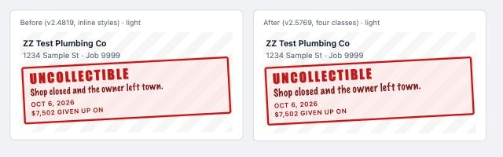

# v2.5769 — Pipeline: the Uncollectible stamp reads in dark mode (2026-10-23)

The owner, 2026-10-23, with a dark-mode screenshot of the Collections rows: "I do not like how uncollectible looks on dark mode. Help me improve this and take screenshots and choose better colors that are better contrasting, but still visually attractive." Punch list #145; the to-do's `mockup.html` has today's stamp and three options side by side in both themes, with the WCAG ratio on every line.

- **What was wrong**: the stamp (v2.4792, v2.4819) was drawn inline for light — a 60% pink panel, red stencil, red handwriting. The red text tokens lighten in dark; the panel did not, so 60% pink over the `#111827` row blended to mauve grey `#9f9197`, and salmon on mauve read at 1.09:1 (the word) and 1.59:1 (the reason, the day and the dollars).
- **Dark now** (`.stagesUncollectibleStamp` and its three children in `src/index.css`, under `:root[data-theme='dark']`): panel `var(--bg-red-100)` (`#4c1d1d`), frame `#ef4444` (4.71:1 on the row), the word `#ff8a65` (6.03:1 on the panel), the reason in `var(--text-strong)` (13.4:1), the day and the dollars in `var(--text-red-800)` (7.36:1). The handwriting face stays; only its ink changes.
- **Light**: pixel-identical to v2.4819 but for the reason, 0.9rem → 1rem in both themes.
- **Where**: `StagesUncollectibleStamp.tsx` drops its inline styles for four classes; `data-stages-uncollectible-stamp`, `role="note"` and the aria-label are as they were, so `JobsStagesTab.render.test.tsx` reads the stamp unchanged.

## Is this the best we can do? Are we being straightforward?

1. **A, not B or C.** B (a quiet red-outlined pill at the row's top-right, the reason as a muted paragraph) turns the stamp into a chip like every other chip on the row; C (the stamp as the word, the day and the dollars, the reason in the row's note style) splits the why from the mark v2.4792 built to carry it. A keeps the mark the office knows and fixes every number.
2. **Light untouched.** The complaint was dark only; light is the stamp the owner approved twice.
3. **Numbers, not adjectives.** Every ratio above is computed on the panel blended over the row's ground and is written on the mock-up.
4. **One stamp, two palettes.** The next palette change is a stylesheet edit, not a component edit.
5. **Cut**: a lighter-weight dark panel (the stripes under it would show through and the word would lose its ground), the reason in the row's typeface (the handwriting is the stamp's voice; its ink was the problem).

## Verify

`/dev-login?as=1&to=/jobs?tab=stages`, Jump to Collections, the Uncollectible band. In dark: a deep red panel, a bright red frame, red-orange UNCOLLECTIBLE, the reason in white, the day and the dollars in soft red. In light: the stamp as before, the reason one step larger. The theme toggle is in the gear menu.

## Seen on the dev server (2026-11-02, punch list #145 retired)

The app's own stylesheet drawing the stamp on a striped row over invented facts: on the left the inline stamp of v2.4819, on the right this one. The to-do's mock-up lives in git history at the deleting commit.

Measured from the computed colours of a live Collections row in dark, on the row's ground `#111827` (the mock-up's ground; the stripes left out as it left them out): the word 6.05:1, the reason 13.39:1, the day and the dollars 7.37:1, the frame on the row 4.71:1 — the mock-up's numbers. The pictures sit on `var(--surface)` (`#1f2937`), where the inline stamp reads 1.00:1 (the word) and 1.46:1 (the rest), this one the same as on the live row but for the frame at 3.90:1. Light reads 5.74:1, 8.89:1 and 7.38:1 before and after alike, the frame 6.47:1.
