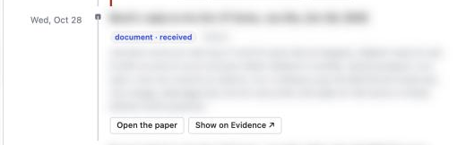
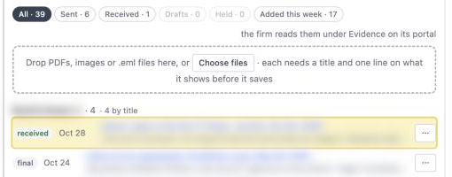
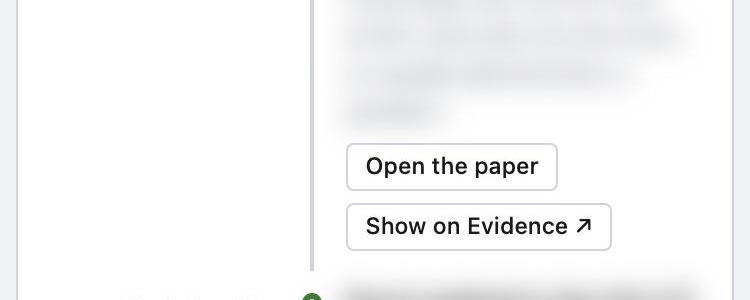

# v2.6166 — Legal desk Timeline: open the paper from the line, or land on its Evidence row (2026-10-30)

The owner, on the Legal desk's Timeline, 2026-10-30: *I would like to be able to open evidence right from this view instead of being brought over to Evidence, but I would also still like to be able to navigate to Evidence, and when I do, have that row of evidence become highlighted.* Until now every document line on the Timeline (v2.5800; the paper's own day since v2.5846) ended in one door, **Open Evidence ↗**, which switched tabs and left the reader to find the row among the groups (v2.6108).

## What changed

- **Two doors on a document line** ([`LegalTimelinePanel.tsx`](../../src/components/jobs/legal/LegalTimelinePanel.tsx)): **Open the paper** (`data-legal-timeline-open-paper`) opens the file itself in a new browser tab without leaving the line — the Evidence row's own open, lifted into [`legalMatterDocumentsIo.ts`](../../src/lib/legal/legalMatterDocumentsIo.ts) as `openLegalMatterDocument` (a 15-minute signed link from the `legal-matter-documents` bucket, `window.open` with `noopener`) so both open one way; a file the session may not read, or one gone from the bucket, reads its reason under the line in `formatErrorMessage`'s words (`data-legal-timeline-open-error`, `role="alert"`). **Show on Evidence ↗** (`data-legal-timeline-show-evidence`) lands the Evidence tab on that row. The event's and the folded burst's doors say *Show on Evidence ↗* too and land on their first document. The firm's portal passes neither and draws the line as before.
- **The landing** ([`LegalMatterDocumentsPanel.tsx`](../../src/components/jobs/legal/LegalMatterDocumentsPanel.tsx), `landOn` / `onLandingDone`): the row scrolls into view (`block: 'center'`, smooth unless `prefers-reduced-motion`) and wears `.legalDocLanded` (`index.css`: `--bg-amber-100` and a `--border-amber` ring, fading over four seconds; under reduced motion the tint stands still and goes when the class comes off at `EVIDENCE_LANDING_LIT_MS`). The kernel [`evidenceLanding.ts`](../../src/lib/legal/evidenceLanding.ts) decides what the landing finds: `shown`; `behind_filter` (the filter clears to All and one line under the filters says *The Sent filter hid this paper, so every paper shows now.*, `data-legal-document-landing-note`); `gone` (*That paper is no longer on the matter.*). The groups are always open since v2.6108, so only a filter can hide a row. A landing happens once per `landOn`: a reload of the documents (a hold, a send) never scrolls again.
- **The address carries the row** ([`legalDeskRoute.ts`](../../src/lib/legal/legalDeskRoute.ts)): `&tab=evidence&doc=<id>`, written by `legalDeskHref` only with the Evidence tab and read back by `legalDeskFromSearch` (`LegalDeskAddress.doc`), so a reload or a pasted link lands the same way. [`LegalDesk.tsx`](../../src/components/jobs/legal/LegalDesk.tsx) holds `evidenceDoc` (`initialDoc` from the page, `showOnEvidence`, `showTab`), writes it through `onAddressChange` with the tab, and lets it go when the landed row is pressed or the tab changes. The gap list's 📄 press on an answer's document lands on its row too.
- **Tests**: `evidenceLanding.test.ts` (5, the lines held to the plain-words rules), `legalDeskRoute.test.ts` (+1), `LegalTimelinePanel.render.test.tsx` (+3: both doors, the refusal's words, the portal's line), `LegalMatterDocumentsPanel.render.test.tsx` (+3: the lit row and its fade, the filter cleared with its line, the gone paper), `LegalDesk.address.render.test.tsx` (the address carries `doc`).
- **Guide** *review a collections account before it goes to your attorney*: the Timeline section says the two doors and the landing; the Documents section says a title press opens the paper. `GLOSSARY.md`'s *Document (Legal desk)* entry carries the clause.

## Seen on the dev server (2026-10-30)

The live matter's words are blurred; the controls and the days are the app's.

## Deploy

The client alone, with the merge. No migration, no function.

## Test

On the dev server as the dev, an account with documents on its matter, **Timeline**:
1. Under a document line, **Open the paper** opens the file in a new browser tab; the Timeline stays.
2. **Show on Evidence ↗** switches to Evidence; the row scrolls to the middle of the pane, lit amber with a ring, and the tint fades over four seconds; the address reads `&tab=evidence&doc=<id>`. A reload lands the same way.
3. The filter line shows only when the landing arrives while Evidence is open with a filter on — the filter is the panel's own state and resets when the tab is left, so a Timeline press always finds All. On Evidence press **Sent**, then press the 📄 on a gap answer's document above the tabs (a received paper): the filter reads All, the row lights, and one line under the filters says the Sent filter hid it. The render test holds the same case.
4. Press the landed row (its ⋯ or its title): `&doc=` leaves the address. Press another tab: it leaves too.
5. At 375 px the two doors sit under the line on one or two rows, with no sideways scroll.
