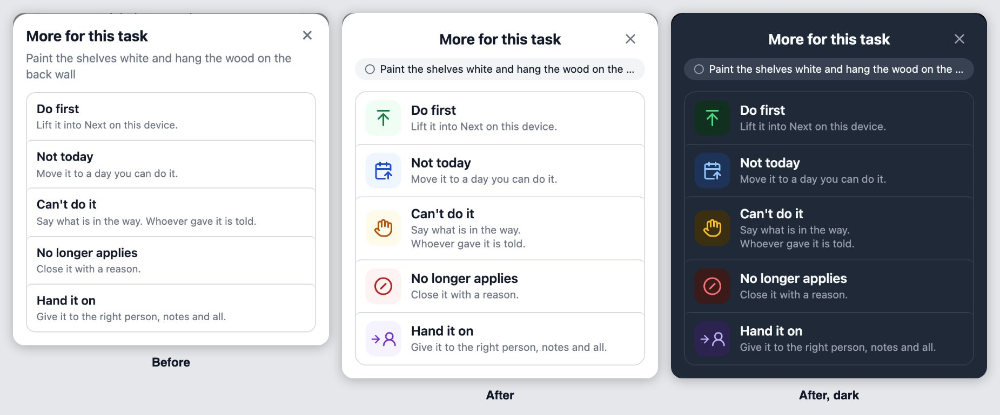
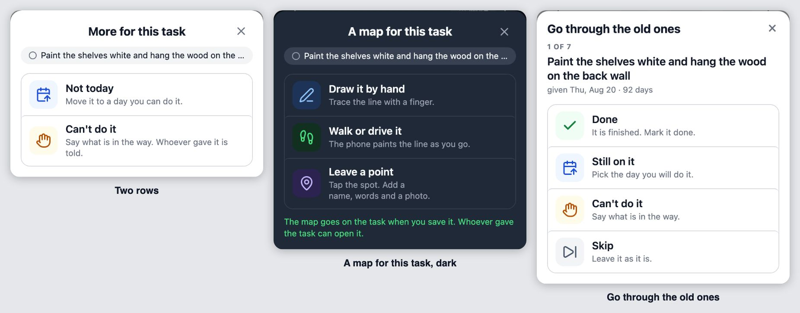
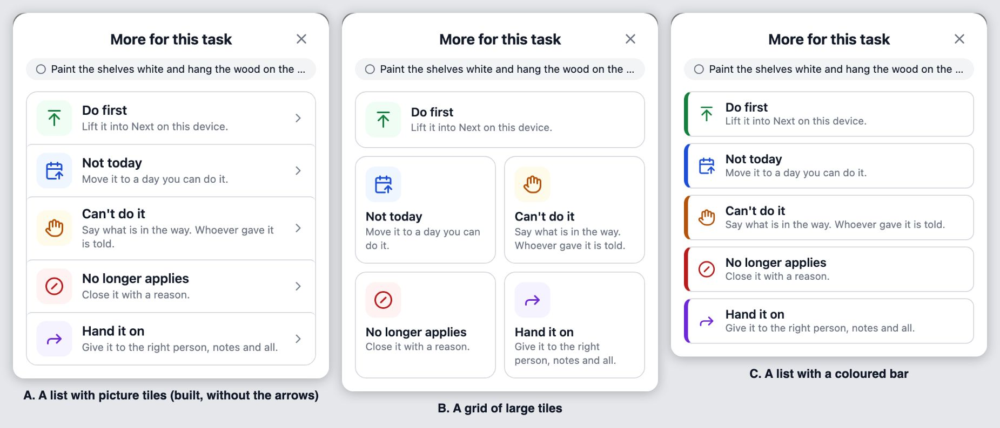

# v2.8034 — Checklist: More for this task shows each choice with a picture (2026-11-20)

The owner walked the Checklist on a phone on 2026-11-20 and marked up the sheet behind a task's **⋯ More**: "When a user clicks more from this task, I don't like how the task is presented, below the title 'more for this task'. Please center 'more for this task' and I want to do a better job of showing as well as telling the four options below". In his shot the two grey lines that repeat the task under the title are struck through.

No migration and no edge function. The words of every row are as they were, and each row opens the window it opened before.

## What a person sees

- **The title is centred**, with the close press at its right.
- **The task is one line in a quiet pill** under the title: a small ring, as on the task's own tick, and the task's words, cut with an ellipsis when they are long. It replaces two muted lines. The pill stays because the sheet can cover the card it was opened from, as it does on a task low in the list, and then it is the one thing that says which task the choice is for.
- **Every row leads with a picture** in a tinted tile 44 px square, then the name and the one line. A row is at least 64 px tall.

| Row | Picture | Colour |
|---|---|---|
| Do first | an arrow to a top line | green |
| Stop doing it first | an arrow turning back | grey |
| Not today | a calendar with an arrow | blue |
| Can't do it | a raised hand | amber, the stuck mark's own colour |
| No longer stuck | a thumb up | green |
| No longer applies | a struck circle | red |
| Hand it on | an arrow to a person | violet |

**A map for this task** (the 🗺 Map press) is the same sheet, so it has the centred title, the pill and a picture for each way in: a pen, footsteps and a pin. **Go through the old ones** draws its answers with the same rows, so Can't do it wears the same hand there as under More. Its own head, with the task in large words as the question, is as it was.

## The three layouts tried

Each was drawn on the real sheet and compared at phone width, in both themes.

- **A. A list with picture tiles** was built. The picture is large enough to read first, the rows keep the kernel's order top to bottom, and two rows or six look alike. The small arrows at the right were dropped: three of the rows act on the press and open nothing, so an arrow there would say something untrue.
- **B. A grid of large tiles** has the biggest pictures, but each line of words wraps to two or three, the order no longer reads top to bottom, and an odd count needs one wide tile.
- **C. A list with a coloured bar** is the shortest, but its picture is small and a bar's colour alone says little.

The task's words in these shots are made up.

## How it is built

| Piece | Where |
|---|---|
| The picture of each row, beside its key | `TASK_MORE_PICTURES`, `TASK_MAP_START_PICTURES` and `PASS_ANSWER_PICTURES` in `src/lib/tasks/taskDoerActs.ts` |
| The rows | `src/components/checklist/TaskChoiceRows.tsx` |
| The sheet | `src/components/checklist/TaskChoiceSheet.tsx` |
| The pass | `src/components/checklist/TaskPassSheet.tsx` |

A `TaskChoice` now carries a `picture`, a drawing's name and a tone, so a new choice cannot ship without one. The kernel stays pure: it names the drawing, and `TaskChoiceRows` holds the icon for each name and the theme's tint and ink for each tone. Handing on is drawn as an arrow beside a person, two icons of the set, since no one icon draws it. The picture is hidden from a screen reader, which reads a row as its name and its line.

The tiles are the theme's tint tokens under its text tokens, so each pair holds in dark. The second line of a row is balanced, so a line that wraps at 390 px breaks at its full stop and leaves no word alone.

## Tests

- `src/lib/tasks/taskDoerActs.test.ts`: every row of More carries the picture of its key across every shape of task, no two rows of one sheet share a drawing, and the four ways out differ by colour too.
- `src/components/checklist/TaskChoiceSheet.render.test.tsx`: the centred title, the one-line pill, every row More can return drawn with its picture and read by its name and line, and the rows' key attribute and dead state in the pass.

Walked on the running app at 390 and 375 px in light and dark: each of Not today, Can't do it, No longer applies and Hand it on opened its own window, and nothing was written.
