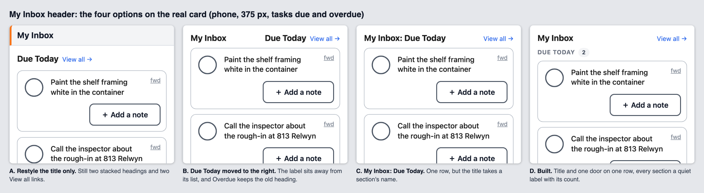
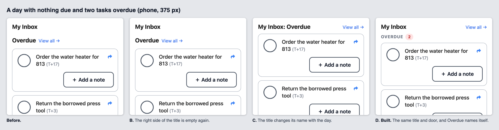
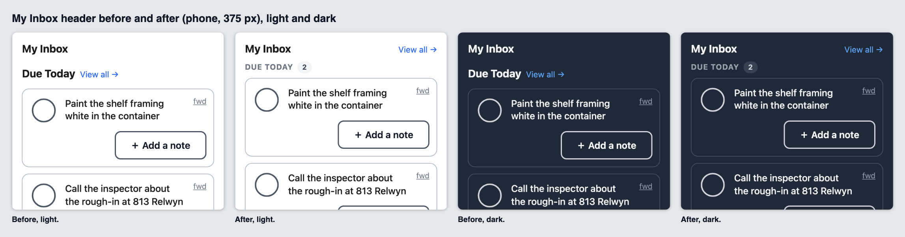
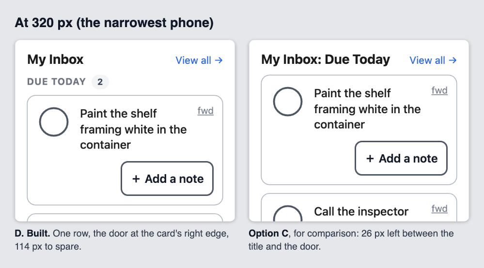
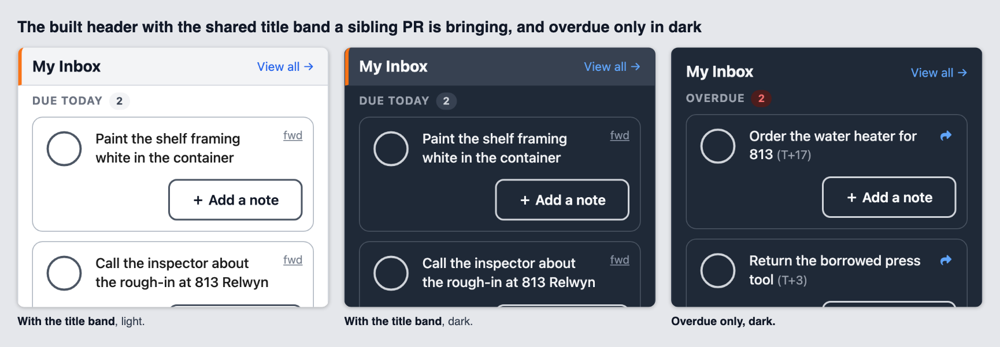
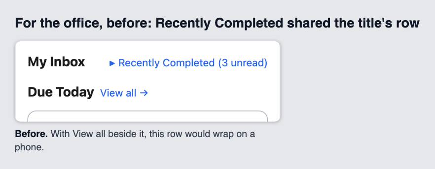
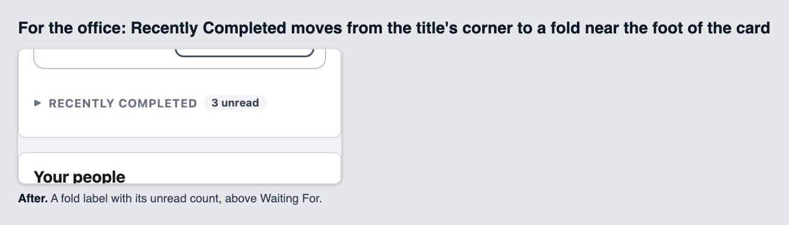

# v2.8040 — My Inbox: the title and View all on one line, and a quiet label for each section (2026-11-20)

The owner walked the app on an iPhone on 2026-11-20 and circled two things on the Dashboard's My Inbox card: the empty space to the right of "My Inbox", and the "Due Today · View all →" row under it. The card opened with two stacked headings of nearly the same weight. The owner named three ways out and the lead session a fourth. All four were laid out on the real card and the fourth was built. Client only: no migration, no edge function.

## What the code said first

- **"View all →" belongs to the whole inbox.** Due Today's link went to `/checklist` and Overdue's to `/checklist?tab=review`. The Checklist page lands both on the same tab for every role: Review for a role with the office tabs and Task Mode off (`hasOfficeChecklistTabs`), Today for everyone else (`officeTabLandsOnToday` bounces a crew person off Review). So one door on the title's row opens everything the two did.
- **Due Today is not always the first section.** It draws only when something is due today. A day with nothing due and tasks overdue opens on Overdue, and a card can hold Waiting For alone.
- **The title's row was not empty for the office.** `headerRight` held the **Recently Completed (N unread)** corner link. Beside a door it would wrap the row on a phone (about 80 + 215 + 78 px in 325).

## The four options

- **A. Restyle the title only.** The two stacked headings and the two links stay. The shared title style is a sibling PR's work and lands on this card by itself.
- **B. "Due Today" moved to the right of the title's row.** The label leaves its list, Overdue keeps a heading of the old weight, and on a day with nothing due the right side is empty again.
- **C. "My Inbox: Due Today … View all →".** One row, and the shortest card on a day with tasks due. The title then has to change its name with the day ("My Inbox: Overdue"), which costs the card its landmark (the dock's chip reads **My Inbox**), and the first section is named in the title while the others are headings. At 320 px 26 px are left between the title and the door.
- **D. Built.** "My Inbox" at the left and the one door at the right, as My Schedule does with **Calendar →**. Every section is a label of one quiet weight with its count.

To swap to another option, ask for it by its letter.

## What changed

- **The title's row.** `DashboardMyInboxCard` passes the door as `DashboardGroupCard`'s `headerRight`: `MY_INBOX_DOOR` (**View all →**, `/checklist`). The press is 44 px tall. Its negative margins give that height back, so the row stays as tall as its title, and it sits at the card's right edge. `DashboardGroupCard` itself is untouched, so the shared title style drops in with no conflict.
- **The sections.** Due Today, Overdue and Recently Completed each open with `MyInboxSectionHead`: an `h3` in small capitals (`0.8125rem`, `var(--text-muted)`) with its count in a pill, red for Overdue. They were `h2`s of the title's own size. The count is what is still open and now draws on a phone too (it drew on a desktop only).
- **Recently Completed** is a fold label near the foot of the card, above Waiting For, with its unread count in the pill. Its press is 44 px tall. Quirk #13 holds: it draws only when something was completed.
- **The rule is in the kernel.** `myInboxSectionLabels` in `src/lib/dashboardMyInbox.ts` answers which labels draw, in what order and with what count. The title never takes a section's name.

The band in the last sheet is a stand-in drawn from the sibling session's working style, to show the two changes together.

## Verified

On the dev server as a dev, with made-up task rows fed at the network layer and every write refused, at 375 px and 320 px in light and dark and at 1280 px:

| State | Title's row | Labels |
| --- | --- | --- |
| Tasks due and overdue | "My Inbox", one door, one row | Due Today 2, Overdue 2 |
| Overdue only | the same | Overdue 2 |
| Due only | the same | Due Today 2 |
| Office, something completed | the same | Due Today 2, Overdue 2, Recently Completed 3 unread |
| Empty inbox | the card is not drawn, as before | none |

The door measured 78 × 44 px with its right edge on the card's inner edge at every width. The card is one component on the Dashboard's three role positions, Job Mode, Dispatch Mode and Quickfill, so the header is the same in each.

## Tests

- `src/lib/dashboardMyInbox.test.ts`: the door, the labels' order and counts, Overdue alone on a day with nothing due, no pill at zero, no labels for a card with Waiting For only.
- `src/components/dashboard/DashboardMyInboxCard.forward.render.test.tsx`: one `h2`, one door on the title's row to `/checklist`, the labels with their counts, and Overdue alone.

## Docs

The Dashboard map's My Inbox dossier and quirk #13, the Glossary's **My Inbox (Dashboard)**, and the guide `dashboard-my-inbox`.
