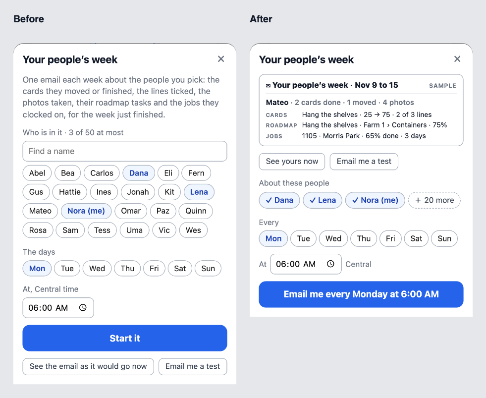
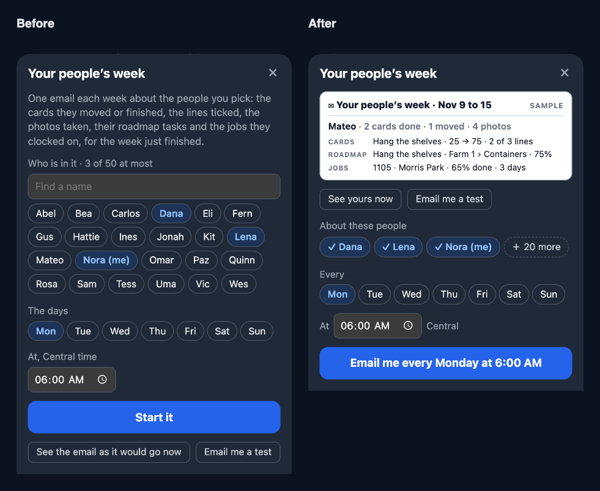
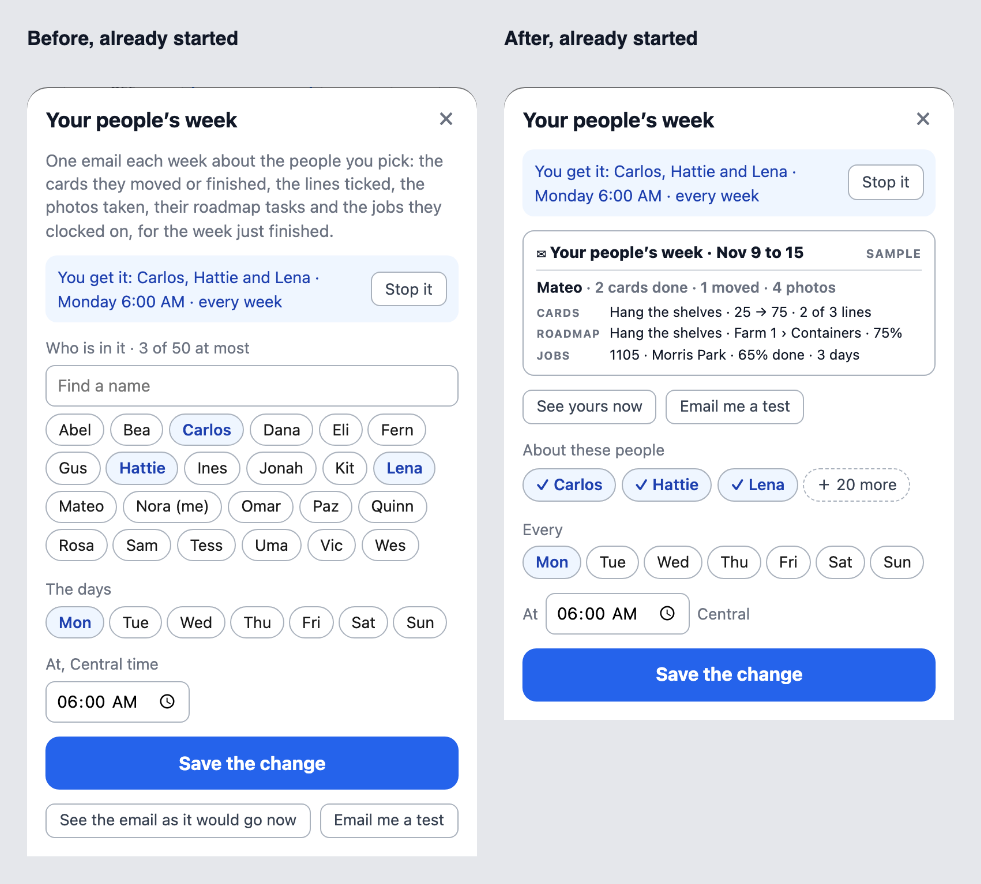
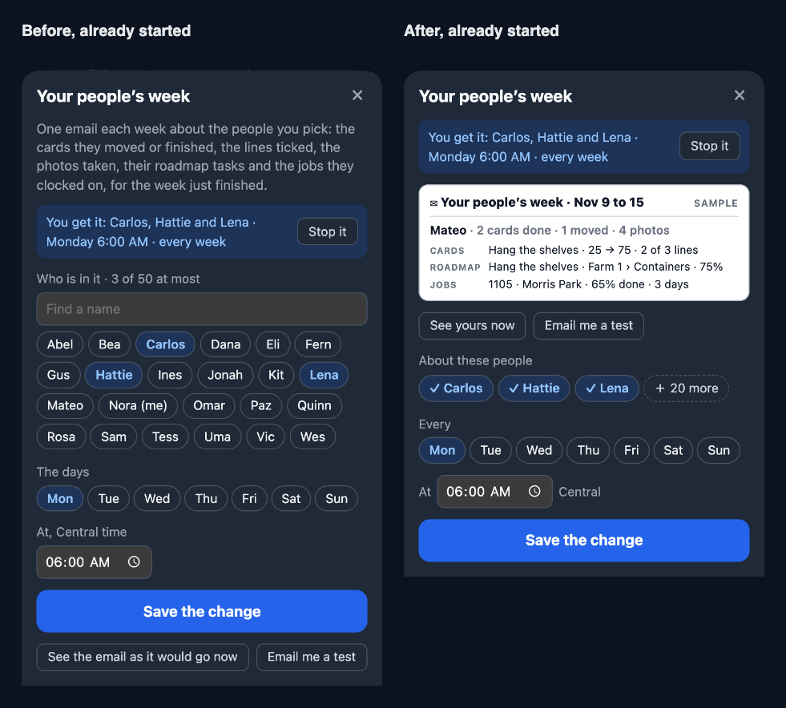
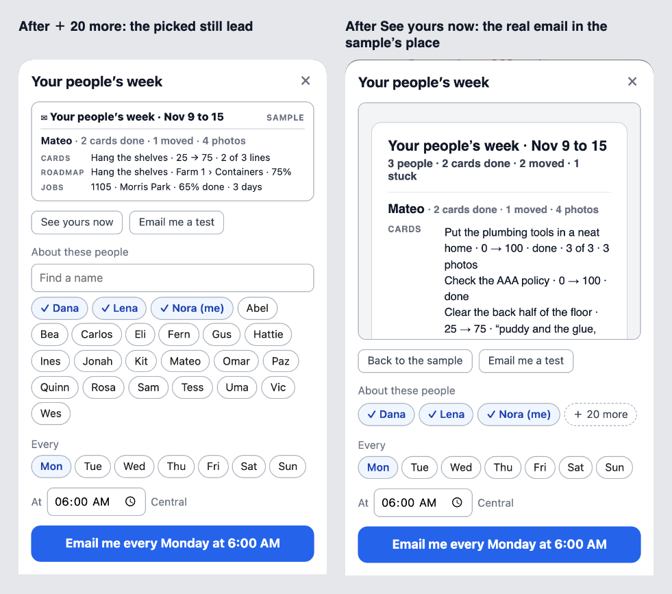
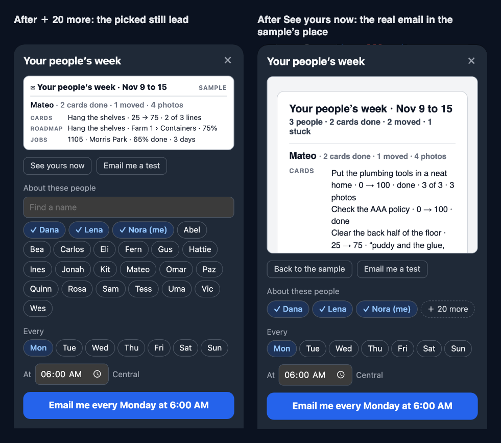
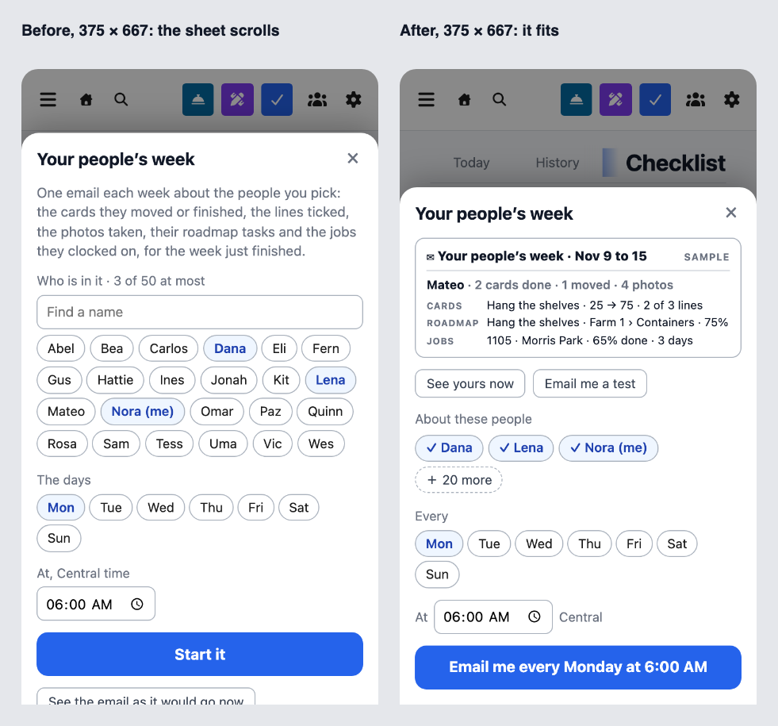
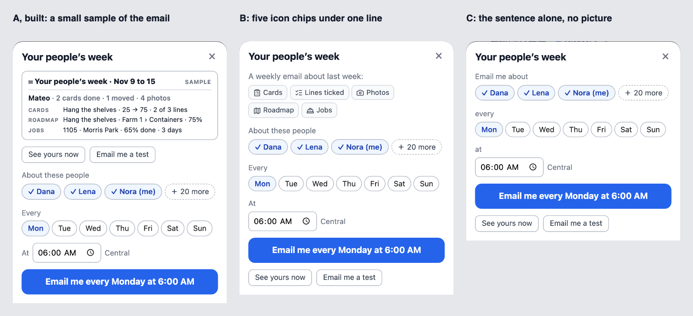
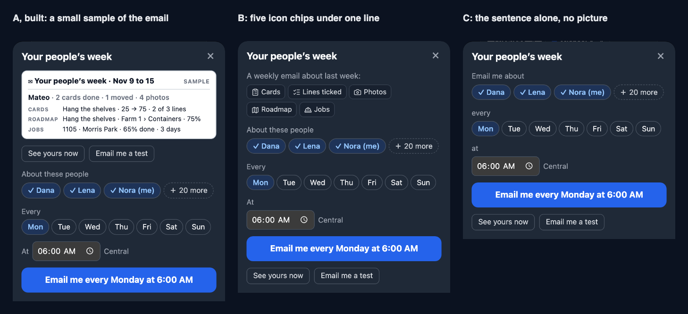

# v2.8041 — Your people's week shows the email instead of describing it (2026-11-20)

The owner, walking the app on an iPhone, 2026-11-20, on the sheet behind **✉ Email me their week**: "I don't like this blurb at the top, how could I improve this where we do our best to show instead of tell or make things intuitive enough we can use less words". The blurb was four grey lines listing what the email holds, over a wall of 23 name chips with the three picked ones somewhere inside it.

- **The top is the email, small** (`peopleWeekGlance` in `src/lib/peopleWeek.ts`): the subject for the week just finished and one made-up person, every line written by the email's own kernel (`peopleWeekSubject`, `personLine`, `cardLine`, `roadmapLine`, `jobLine`), tagged *Sample*. It shows the five things the paragraph listed: cards done and moved, lines ticked, photos, a roadmap task, a job with its days. It stays light on either theme, as the real email's frame already did.
- **See yours now** sits under the sample (it was *See the email as it would go now*, last on the sheet) and draws the real email where the sample was; **Back to the sample** returns. **Email me a test** sits beside it, and its *A test went to your email.* answers there.
- **The picked people lead** (`peopleWeekPickList`): the people picked when the sheet opens come first, each with a tick, and a list over ten folds everyone else behind **＋ N more**. Pressing it opens the whole list with the find box. The order holds while the sheet is open, so a chip never moves from under a finger; a find reads the whole list.
- **Labels that read as one sentence**: *About these people* (the cap of 50 is said only once reached), *Every*, *At … Central* on one line.
- **The blue press says the act** (`peopleWeekStartWords`): *Email me every Monday at 6:00 AM*, *Email me every Mon and Thu at 1:30 PM*, *Email me 3 days a week at 6:00 AM*. It was *Start it*. *Save the change*, *Stop it*, *Pick who* and *Pick a day* are as they were.
- **A standing email leads**: *You get it: … · Monday 6:00 AM · every week* with **Stop it** is now the first line under the title.
- **Shorter**: at 390 px the first-time sheet went from 596 px to 477 px, a started one from 666 px to 547 px. At 375 × 667 the old sheet scrolled inside its 600 px cap; the new one is 543 px and fits. At 320 × 568 both scroll, 734 px before and 617 px now.

## Is this the best we can do?

Three treatments were drawn on the real sheet at phone width, in both themes. The names in every picture are made up.

- **A, built: a small sample of the email.** It shows the thing itself, and every fact the paragraph held is still on the sheet before the first press: an email (the envelope, the blue press), weekly and on the chosen day and time (the blue press), about the people picked (*About these people*), for the week just finished (the dates in the subject).
- **B: one line and five icon chips** (*Cards, Lines ticked, Photos, Roadmap, Jobs*). Shorter than A by about 55 px, but it still tells: the chips name the five things and show none of them.
- **C: the sentence alone** (*Email me about … every … at …*), no picture. The shortest, 364 px, and it drops what the email holds, which a first-timer needs.

To swap, ask for B or C by letter: the pick list, the labels and the blue press are shared by all three, so only the block above the people changes.

## Where

- `src/lib/peopleWeek.ts`: `peopleWeekGlance`, `glancePerson`, `peopleWeekPickList`, `PEOPLE_WEEK_FOLD_OVER`, `peopleWeekStartWords`, `peopleWeekAboutWords`, `PEOPLE_WEEK_SHEET_WORDS`. `src/lib/peopleWeek.test.ts` holds the picture to the email (each of its lines must be in `renderPeopleWeekHtml` about the same person), the press words, the fold and the plain-words rules.
- `src/components/checklist/PeopleWeekSheet.tsx` and its render smoke (the sample at the top, the real email in its place and back, a long list folded with the picked first and a pick staying in place).
- The guide *get a Monday email of your people's week*, `docs/CHECKLIST_TABS_ARCHITECTURE.md` and the `people-week-email` preview line in `docs/EDGE_FUNCTIONS.md` name the new controls.
- The Dashboard's **✉ Get this every Monday** opens the same sheet, so it changed with it. Settings → Email streams names the email and the press that opens the sheet, both unchanged.

## How it was checked

On the running app at 390 × 844, 375 × 667 and 320 × 568, light and dark, signed in through `/dev-login`, with a read-only Playwright walk: no write reached a table, the names were swapped for made-up ones on the way in, and the *already started* state was a row stood in on the read, so the live site was not touched.
