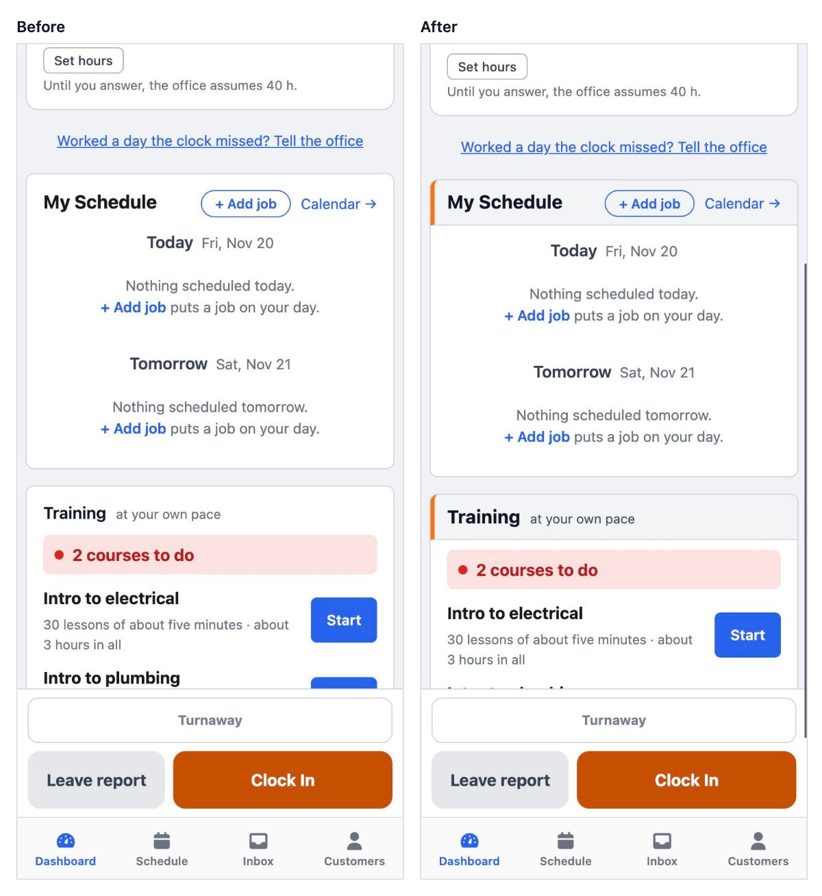
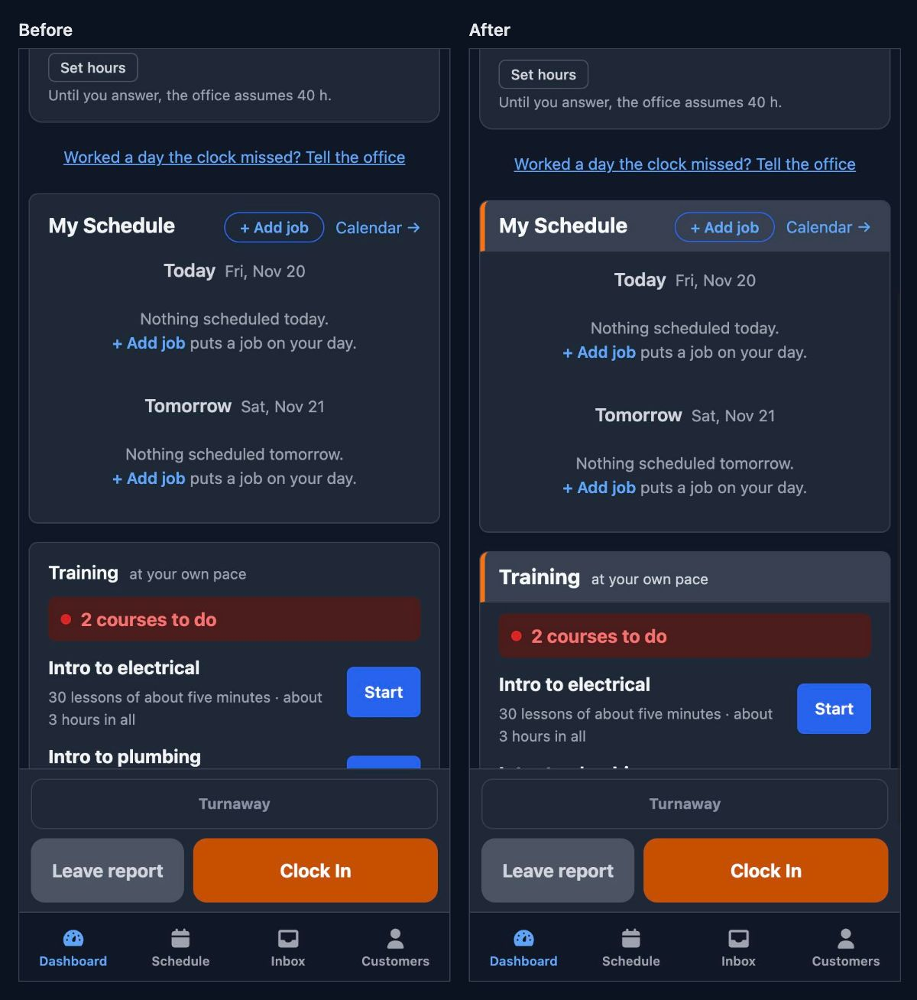

# v2.8044 — Dashboard: every card's title sits in a band, so a section is easy to spot (2026-11-20)

The owner walked the app on an iPhone on 2026-11-20 and circled *My Schedule* and *Training* on the Job Mode home: "on the dashboard, I would like titles like My Schedule and Training to stick out more like in the Edit Job modal such that it is easier for a user to navigate". The titles were plain bold words inside a white card and read much like the content under them. No migration and no function.

## What changed

- Every Dashboard card opens with a **head**: a tinted band across the card's top with the brand-orange left edge, the title in it. It is the Edit Job window's section heading (`jobFormSectionHeaderStyle.ts`) fused to the card.
- The band reaches the card's own edges, and its side padding is the card's own. The title's row is exactly as wide as it was, so the presses beside a title (*+ Add job*, *Calendar →*, *New Bid*, the fold arrows) stay on their line at every width.
- A folded card (*Assigned Jobs*, *HR Report*, *My Bids*, *Recent Reports*) is the band alone, which is the Edit Job heading as it stands there.
- A section with no card around it (*Superintendent Jobs*, *Upcoming inspection*, *Trial helpers*, *My crew*) gets the band standing by itself.
- *Needs you* draws its band under the Lien desk strip when the strip shows, square, edge to edge.
- Every band is at least 44px tall, and every title is 18px bold. *Training*, *My Time*, *My Vehicle* and *Your jobs on a map* were 16px, *The office's round* 15px, and *Waiting on …* a small grey eyebrow.
- Small grey words inside the band (*at your own pace*, *27 for others*) are one step stronger there. On the tint the muted tone measured 4.39:1 in light and 4.06:1 in dark; `--text-600` is over 6:1 in both.
- Headings: each card's title is an `h2`. *Training*, *My Time* and *My Vehicle* had no heading at all, and the map's was an `h3`. The three headings inside the Billing Pipeline (*Field: Waiting for Approval*, *Ready to Bill*, *Billed Waiting for Payment*) were `h2` and are `h3`, drawn as before.

## Three ways tried, on the real Job Mode page at 375 wide, light and dark

1. **The Edit Job heading on the title alone**, a small banded tag around the words. It moved nothing, but it read as one more press beside *+ Add job*.
2. **A heavier title with an orange bar**, no tint. The weakest break of the three, and at a size big enough to stand out *My Schedule* leaves its presses no room on a phone once the dispatch phone button is beside it.
3. **The title's whole row as the Edit Job band, inside the card.** The strongest break, but the band's own padding takes 29px from the row. By the widths measured, *My Schedule* with the dispatch phone button would wrap at 375 and at 390 (the dev's own page has no phone button, so that is worked out, not seen).

The one built is the third with the band carried out to the card's edges, which gives the row its width back.

## Files

| File | What it holds |
|---|---|
| `src/lib/dashboard/dashboardCardTitleStyle.ts` | The band and the title as styles: `dashboardCardHeadStyle({ card, below, closed })` and `DASHBOARD_CARD_TITLE_STYLE`. Pure. A change to how a card's title reads is made here. |
| `src/components/dashboard/DashboardCardTitle.tsx` | `DashboardCardHead` (the band, around the row the card laid out) and `DashboardCardTitle` (the `h2`). |
| `DashboardGroupCard.tsx` | The shared card behind My Inbox, Your people, Teams Inbox, Assigned Jobs, Team Ready to Bill, Projects, HR Report and the sub's and partner's cards. |
| My Schedule, Training, My Time, My Vehicle, Needs you, The office's round, Waiting on, Crew Day, My Bids, Recent Reports, Your jobs on a map, Billing Pipeline, Your record, Your week, Superintendent Jobs, Upcoming inspection, Trial helpers, My crew | Each title row moved into the head. Nothing else in the card changed. |

## What it does not do

- The leader's short Dashboard (`DashboardShortView`) keeps its small eyebrow heading: it is a page of its own with one card.
- My Inbox gets the band on its title through the shared group card, and nothing else: `DashboardMyInboxCard.tsx` is not in this change. Its *Due Today* and *Overdue* lines stay `h2` for the session that is reworking that card's header row.
- The green *A customer's words* strip, *The lien month* and the Job Mode job card have no title of this kind and are as they were.

## Seen on the dev server (2026-11-20)

`/dev-login?as=1&to=/dashboard` at 375 wide, Job Mode on from the gear menu. Every band measured flush with its card (1px in from the border, top and sides) at 375 and at 1400, sixteen cards on the dev's full page.

## Tests

- `dashboardCardTitleStyle.test.ts`, 7: the band on the common card, on a card with its own padding, folded, under another line, with no card, and the order of the border keys that keeps the orange edge.
- `DashboardCardTitle.render.test.tsx`, 3: the title is the one `h2` inside the band with its presses beside it, the band with no card, and the shared group card folded and open.
