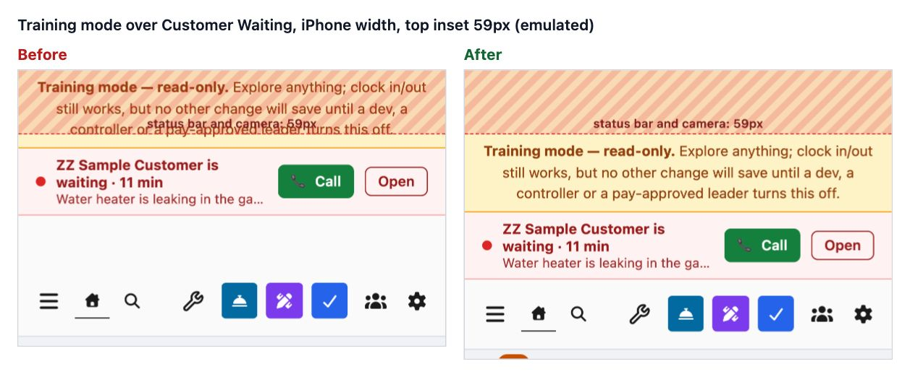
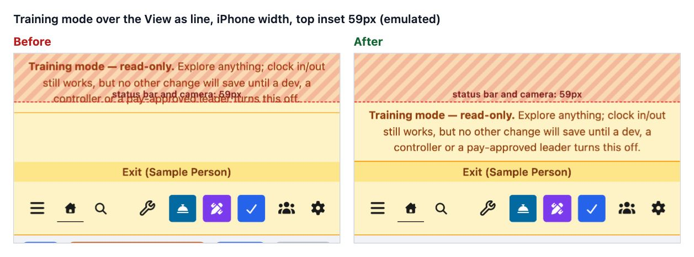
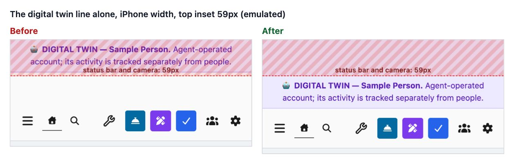

# v2.8053 — On an iPhone, a line above the header no longer hides behind the camera (2026-11-20)

The follow-up v2.8039 left open. That fix put *Loading* below the camera and named a second fault it had read from the code and not seen: the lines the Layout draws **above** the header pay no top inset. This change confirms the fault and fixes it. No migration and no function. One small component, four CSS rules, three screens moved onto them.

## What was wrong

The app is installed on the Home Screen with a translucent status bar, so the page starts at the top of the glass. The header pays `env(safe-area-inset-top)` for the page. Four lines are mounted before the header, as its siblings:

| Line | Who sees it |
|---|---|
| Add Task offer (`AddTaskShortcutBanner`) | a task-capable role, in Safari only |
| Digital twin line | a twin's account |
| Training mode, read-only | a person flagged `users.read_only` |
| Customer Waiting (`CustomerWaitingBanner`) | the members of the inbox a portal request is in |

None of them paid the inset. With one showing, two things went wrong at once:

1. The line started at the top of the glass, so its words sat 5 to 8px down, behind the clock and the camera. Customer Waiting's **Call** and **Open** started 15px down, where a press belongs to the phone.
2. The header under it still padded by the whole inset, so an empty band the height of the status bar opened between the line and the header's row.

A line over the View as line had the second fault in another place: the View as line paid the whole inset in the middle of the stack.

## What changed

- **`AppTopBanner`** (`src/components/layout/AppTopBanner.tsx`) is the one way to draw a line above the header. It draws a `
` and takes the line's own room as `padY` and `padX`. Its `style` type refuses a padding, since an inline padding would beat the class and lose the inset.
- **`.appTopBanner`** (`src/index.css`): its padding is the line's own, and `padding-top` adds `env(safe-area-inset-top, 0px)`. So the first line showing pays the status bar, and its colour runs up under the clock as the View as line's does.
- **`.appTopBanner ~ .appTopBanner`** takes the inset back off: a line under another line keeps its own padding alone.
- **`.appTopBanner ~ .appViewAsStrip`** sets the View as line's padding to 0 under any line.
- **`.appTopBanner ~ .appNavChrome`** sets `--app-nav-safe-top: 0px`, the word the header, the health strip and the search bar already read under the View as line.
- The two inline lines in `Layout.tsx`, both states of `CustomerWaitingBanner` and `AddTaskShortcutBanner` draw in the component and drop their inline padding.

The rules read the siblings, so every line must be a direct child of the Layout's root, before the header. With no line showing no rule matches: the header and `<main>` are as they were. The inset is `0px` in a browser tab and on Android, so nothing moves there.

On an iPhone with a line showing, the header keeps its own 12px above its row, as it does on Android and under the View as line. Before, the 59px inset stood in for it.

## Measured

Headless Chromium on the dev server, 393 by 852 at 3x, touch, signed in as a dev. The top inset was set to 59px with the DevTools call `Emulation.setSafeAreaInsetsOverride`, so `env(safe-area-inset-top)` itself answered 59px and no stylesheet was rewritten. Each line was made to show by rewriting one read on its way back (`read_only`, `is_digital_twin`, one made-up open portal request, an iPhone's user agent for the Add Task offer, the View as key in local storage). Every write was refused. All numbers are px from the top of the glass; a single number did not change.

| Showing | Top line: first words | Top line: first press | Padding of each line under it | Header's own top padding | Header's first press |
|---|---|---|---|---|---|
| No line (control) | — | — | — | 59 | 59 |
| Digital twin line | 7.4 → **66.4** | — | — | 59 → **12** | 111.8 → **123.8** |
| Training mode | 7.4 → **66.4** | — | — | 59 → **12** | 131.3 → **143.3** |
| Customer Waiting | 6.4 → **65.4** | 14.6 → **73.6** | — | 59 → **12** | 120.3 → **132.3** |
| Customer Waiting, the one quiet line on the inbox page | 5 → **64** | — | — | 59 → **12** | 86.7 → **98.7** |
| Add Task offer | 8 → **67** | 13.3 → **72.3** | — | 59 → **12** | 113.8 → **125.8** |
| View as line alone (control) | 63 | 59 | — | 12 | 95 |
| Twin over training mode | 7.4 → **66.4** | — | 6.4 | 59 → **12** | 184.1 → **196.1** |
| Training mode over Customer Waiting | 7.4 → **66.4** | — | 6.4 | 59 → **12** | 192.6 → **204.6** |
| Add Task over training mode over Customer Waiting | 8 → **67** | 13.3 → **72.3** | 6.4, 6.4 | 59 → **12** | 247.3 → **259.3** |
| Training mode over the View as line | 7.4 → **66.4** | — | 59 → **0** | 12 | 167.3 |
| Customer Waiting over the View as line | 6.4 → **65.4** | 14.6 → **73.6** | 59 → **0** | 12 | 156.3 |

Two controls ran the same twelve cases with the inset at 0px: a phone at 393 wide (Android) and a desk at 1400 wide. All 24 rows are identical before and after, to the hundredth of a pixel: every line's place, padding and height, the header's, and where `<main>` starts.

The striped band in the pictures is drawn over the page for the shot. Chromium draws no status bar. The names are made up.

## What was not checked

- **A real iPhone.** The inset here is Chromium's emulation of one. The browser pane reports `env(safe-area-inset-top)` as 0, and no phone was at hand. The owner confirms on the phone after the deploy: turn training mode on for a test person, open the app from the Home Screen, and the amber line should start under the clock with the header right under it.
- **The Add Task offer at a real inset.** It shows only in Safari's own browser, where Safari's bar covers the status bar and the inset is 0px. It was measured at 59px to hold the rule, with an iPhone's user agent in Chromium.
- **Landscape.** A phone on its side has its insets at the left and right, which no line above the header pays, before or after.

## Tests

`src/lib/topBannerInset.test.ts` reads the four rules, the three places that read `--app-nav-safe-top`, and `Layout.tsx`: every element opened between the first line and the header is one of the four mounts, so a bare `
` there fails. The two banner components must draw through `AppTopBanner` with no padding in the tag. The render tests of `CustomerWaitingBanner` and of the View as line pass unchanged.
