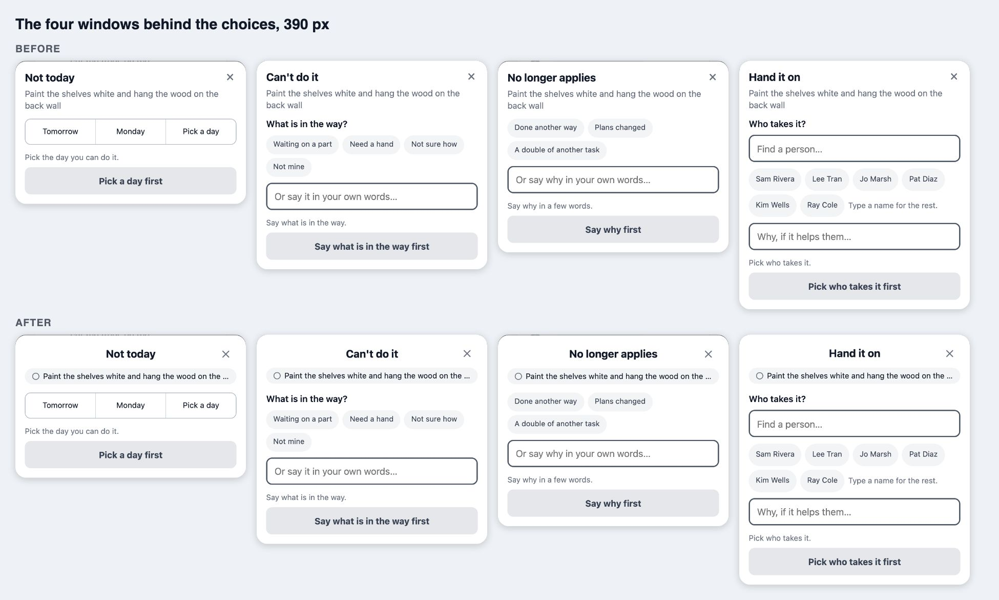
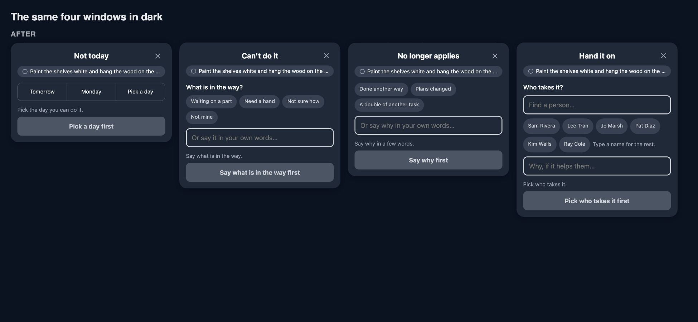

# v2.8057 — Checklist: the windows behind More match its new look (2026-11-20)

v2.8034 gave a task's **⋯ More** sheet a centred title and the task on one line in a quiet pill, after the owner marked up the two grey lines that repeated the task under the title.
The four windows its choices open kept the old top: **Not today**, **Can't do it**, **No longer applies** and **Hand it on** still had a left title, a small "×" and the task in two muted lines.
A person pressed a choice on the new sheet and landed on the look the owner had struck out.
The owner asked for the four windows to follow, on the same day.

No migration and no edge function. Every window asks, says and saves what it did before.

## What a person sees

- **The title is centred**, with the close press at its right, as on More.
- **The task is one line in a quiet pill** under the title: the small ring of the task's own tick and the task's words, cut with an ellipsis when they are long. The whole words stay on the pill's `title`.
- **The close press is 36 px square**, where the old "×" was about 22 px.
- Each window stands as tall as it did: the pill takes the room the second grey line took.

## How it is built

- `src/components/checklist/TaskSheetHead.tsx` is the head, lifted out of `TaskChoiceSheet` as it shipped in v2.8034: the three-column grid that centres the title, the Close press and the pill.
- `TaskChoiceSheet`, `TaskMoveDaySheet`, `TaskStuckSheet`, `TaskDropSheet` and `TaskHandOnSheet` each draw it, with their own title and the id their dialog is named by. The five can no longer drift apart.
- `TaskPassSheet` (**Go through the old ones**) is left alone. Its task is the large line a person answers, one task after another, so a pill would shrink the thing the window is about.

## Tests

- `TaskSheetHead.render.test.tsx`: the head alone, then each of the four windows. Each has a centred title that names its dialog, the task in a one-line pill, no muted paragraph that repeats the task, no pill for a task with no words, and it closes on Close, on Escape and on the backdrop but not on a press inside.
- `TaskChoiceSheet.render.test.tsx` and `useTaskDoerActs.render.test.tsx` pass unchanged.

## Walked

On the dev server against the live data, signed in as the dev, at 390 and 375 px in light and dark: each of the four choices opened its window with the title centred on the window's middle, the pill on one line, and no sideways scroll. Each closed all three ways. Every table write was refused at the network and none was tried. The "before" shots are the same four windows on the deployed site. The task and the names in the shots are made up.
