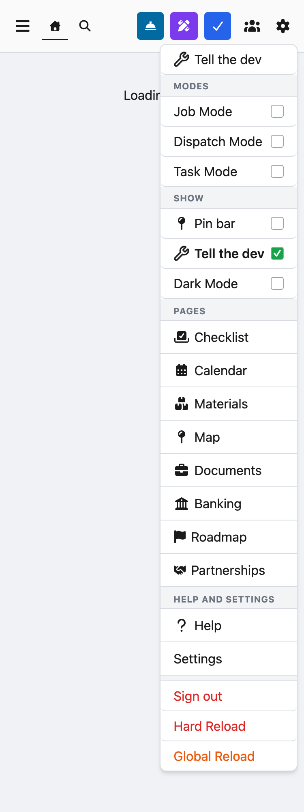
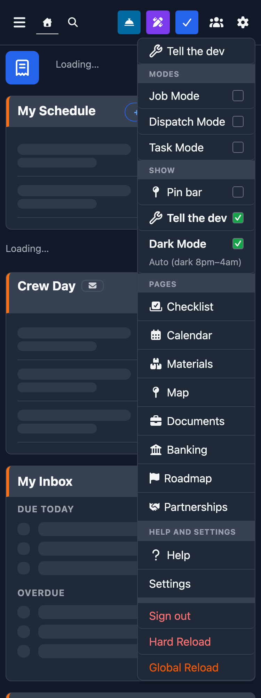

# v2.8059 — Gear menu: the rows are in groups with small labels (2026-11-20)

The owner, after v2.8043 named the menu's two switches for what they show: *"The menu upgrades are very interesting. It makes me think we should improve the entire menu to also include a section for the other pages that are not well-defined."* Under the switches the menu was still one list: pages, help, settings, sign out and the reloads, with the pages in the order they had been added.

## The decision

The owner was shown the whole menu three ways (labels with every row where it was, labels with the pages first, bands with no labels) and chose the first.

| Group | Label | Rows |
|---|---|---|
| The wrench's press | none, first | Tell the dev, only where a narrow phone's header had no room for it |
| The modes | **Modes** | Job Mode, Dispatch Mode with its PO tab, Task Mode |
| The switches | **Show** | Pin bar, Tell the dev, Dark Mode |
| The pages | **Pages** | Checklist, Calendar, Materials, Map, Customers, People, Documents, Banking, Roadmap, Partnerships |
| Help | **Help and settings** | My logbook, Help, Settings |
| Leaving | a grey band, no label | Sign out, Hard Reload, Global Reload for a dev |

No group left its place in the menu. Inside Pages the rows are in one order now, a crew's pages first and the office's last.

## What changed

- **The kernel** [`gearMenuSections.ts`](../../src/lib/gearMenuSections.ts): the four labels, `GEAR_PAGE_ORDER` and `gearPagesInOrder`, which answers the pages a person's menu holds in the menu's order. A new page has one list to join.
- **The gear menu** (`Layout.tsx`): who sees which page is one object, `gearPages`, with every gate as it was. The page blocks are drawn by a map over it, each block gated on its key. A [`GearSectionLabel`](../../src/components/layout/GearSectionLabel.tsx) sits over each group that has a row. The band v2.8043 put under the modes is now the **Show** label, and a band sits over Sign out. The menu clips to its rounded corners, because a label's grey strip can be its first row.
- **The phone dock's More sheet** reads the same four labels from the kernel. Its last group read **Settings** and now reads **Help and settings**.
- **Guides**: `how-the-app-works` says how the menu reads. `pin-mode`, `tell-the-dev-about-a-page` and `task-mode` say *under Show* where they said *under the grey band*.

## How it looks

A dev's menu on a 375 px phone, the longest the menu gets, from the running app.

## What it settles

On a narrow phone the menu holds two rows named Tell the dev (v2.8043's known case). The press that opens the box is above every label. The switch is under **Show**, so the label says which is which.

## What did not change

- No role's menu gained or lost a row, and no row was renamed.
- The menu is taller by its labels: about 80 px on a field hand's phone. The header is not sticky, so the page scrolls under a long menu as it did.

## Tests

- `gearMenuSections.test.ts` (5): the labels, each page once, the full order, the order held for a field hand and for a desk, nothing listed when no page shows.
- `Layout.gearSwitches.render.test.tsx` (4, was 3): on a phone the groups in order with every mode under Modes, the three switches under Show, the pages in the kernel's order with Checklist and Calendar first, Help and Settings, then Sign out and Hard Reload after the band; at a desk the same groups without the header's own pages.
- `PhoneDockMoreSheet.render.test.tsx` (+1): the four labels, and one *Settings* on the sheet where there were two.
