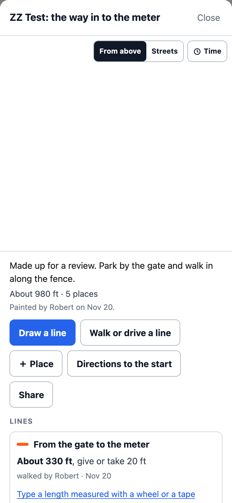
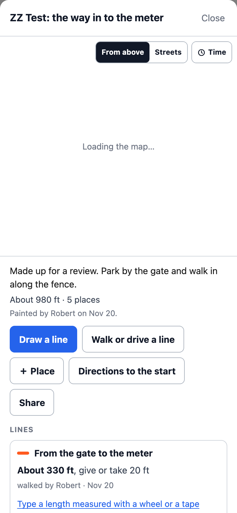
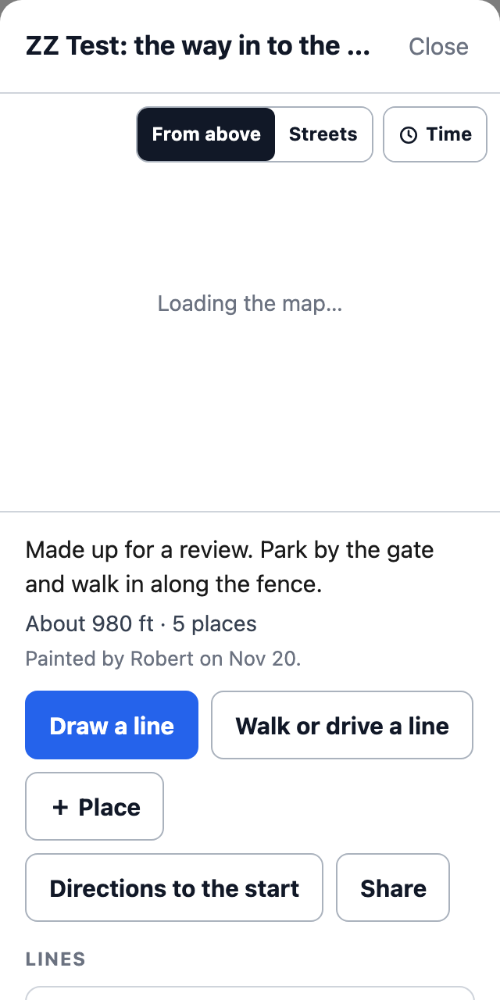

# v2.8078 — Painted maps: a map waiting on Google Maps says it is loading (2026-11-20)

Found by the audit of punch list [#387](../../to-dos/painted-maps-on-google.md) on 2026-11-20. Client only: no migration and no function.

## What was wrong

Since v2.7990 a saved painted map opened to be read draws on Google's map. Until Google's script is in, `PaintedMapGoogleCanvas` holds an empty frame: no map, no line, no place, and no word. On a slow connection that lasts the whole load timeout, ten seconds, before the Leaflet canvas comes up in its place. Before v2.7990 the lines and places drew at once and only the photograph was late.

Walked on the local server with Google's script held back for 14 seconds, on a made-up map on no job:

| Look | Before | After |
|---|---|---|
| 3 s after the window opened | a blank white box under the view presses | *Loading the map…* in the middle of the frame |
| 10.6 s | the Leaflet canvas, with every line and place | the same, and the words gone |

  

## What changed

`PaintedMapGoogleCanvas` draws one line of words in its frame until the loader says the script is in (`loaded`, the fact its doors already read). The words are the window's own for a map that is not up yet, *Loading the map…*, in the muted text token, with `role="status"`.

They sit in the middle of the frame. Set at its top left, as the window's own loading line is, they ran under **From above** at 320 px: the first walk of this fix showed it.

## Tests

`PaintedMapGoogleCanvas.render.test.tsx`, 33 (2 new): with the script held back the frame says *Loading the map…* and stops when the script arrives, and a script that is already in says nothing.

## Not changed, for the owner

- **The ten seconds.** The load timeout is shared with every Google map (`useGoogleCanvasDoors`). A painted map is read in the field, where a slow signal is common, and its drawing is what the reader came for. A shorter wait for this one canvas, or the lines drawn on the Leaflet canvas while Google loads, is a choice and not a mend.
- A script that fails outright (no signal at all, or a blocker) still falls back at once: walked at 0.3 s.
