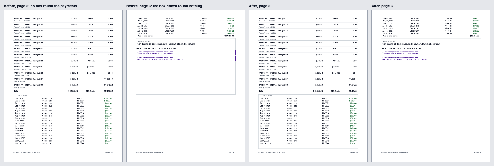

# v2.8089 — Sub papers: a box that runs over a page is drawn on both pages (2026-11-20)

Client only: no migration, no edge function. Punch list #350, found in the audit of the card. `supabase/functions/_shared/subPapersPdf.ts` is drawn in the browser alone (`drawSubPaperPdf`), and no function bundles it.

## Before

`Writer.boxed` drew one rectangle after its body, from the title's height to the last line's. When the body ran over a page, the title's height was on one page and the last line's on the next, so the rectangle went on the last page with a height below zero: the first page had no box round its lines, and the last page had a box hanging below the text round nothing.

Read on prod on 2026-11-20, counts only: the statement of account to date runs past one page for 3 of the 14 people who have papers, and for 2 of them **Last payments** crosses the break.

Two lists drew with no page check. *Paid in this period* could land in the foot's margin. A payment record's **After this payment** drew every open statement on one page, so past about 30 open statements the list ran over the foot and off the sheet. Nobody is there today: the longest such list on prod is 8.

## What changed

- `boxed` notes the page it starts on and the page it ends on, and draws a rectangle on each: from the title to the page's foot, then from the next page's head to the last line.
- **After this payment** and the two totals inside a box ask for room before they draw, as the rows of **Last payments** already did.
- No model changes, so no figure, number or fingerprint moves and no paper becomes a new revision.

## Tests

`src/lib/subWorkOrders/subPapersPdf.test.ts` (+2), over a stand-in for pdf-lib that keeps what each page was asked to draw:

- A statement with 45 payments: every box stands the right way up inside the page, each page's payments sit inside a box on that page, and so does *Paid in this period*.
- A payment record with 60 open statements: it runs to a second page and no line is drawn under the foot.

Both fail on the kernel as it was.
