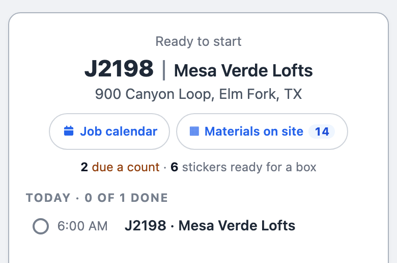
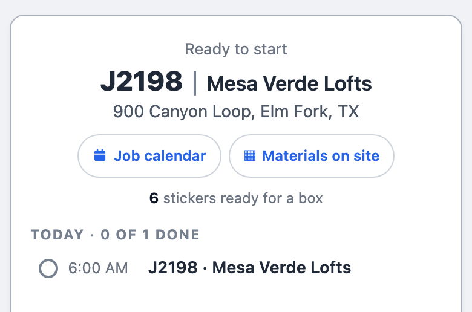
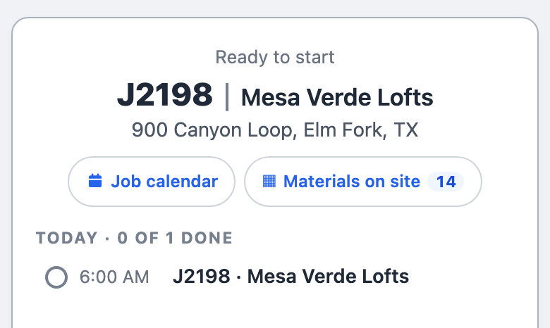

# v2.8103 — Job Mode: the card says when boxes are due a count and when stickers wait for a box (2026-11-20)

The last two pieces of punch list #407, at the owner's word on 2026-11-20: *"Due a count" on the press, which needs a small database function*, and *the stickers-waiting line, which belonged to Way A*. One migration, no edge function.

## What changed

- **One line under the job's two presses, only where there is news.** `DashboardJobModeCard.tsx` draws `job-mode-materials-news` under Job calendar and Materials on site: *2 due a count · 6 stickers ready for a box*. The boxes due a count read amber, as they do on the office's page. A site with nothing due and no stickers waiting draws no line, so the card is as short as before.
- **Why a line and not the press.** The press is a pill beside another pill. A second number on it pushed the pair onto two rows at phone width. The line keeps the pair on one row and says what its number counts.
- **Stickers before the first box.** The owner, 2026-11-20: *the office hands them a sticker, but they can identify materials and a box on their own*. A site whose stickers are printed and on no box yet says *6 stickers ready for a box*, with no count on the press. Printed stickers are the sign that material will be left there.
- **One read, in the database.** `on_site_door_facts(p_job_id)` ([`20261120070000`](../migrations/20261120070000_on_site_door_facts.md)) answers the site's live boxes, the ones due a count and the stickers on no box, `SECURITY INVOKER`, so each number is what the reader can open. Due a count is the app's own rule, never counted or 14 days since the last count. It replaces the three small reads of v2.8050.
- **The client may deploy first.** `fetchSiteDoorFacts` ([`siteBoxCountIo.ts`](../../src/lib/materials/siteBoxCountIo.ts)) falls back to v2.8050's head count when the database answers `PGRST202`, with nothing due and no stickers. Walked against prod before the push: the press read its count and no line was drawn.
- **Kept on the phone.** `useSiteDoorFacts` (the hook was `useSiteBoxCount`) keeps all three numbers, and reads a count the first build kept as boxes alone.
- **Each number is a value in place.** `siteDoorNews` ([`siteBoxCount.ts`](../../src/lib/materials/siteBoxCount.ts)) marks each number with `val` and the card draws it with `ValueSentence`.

| Due a count and stickers | Stickers before the first box | Nothing due |
|---|---|---|
|  |  |  |

The pictures are the dev server at phone width with a made-up stop and made-up numbers.

## Also walked: the Procure link on a live bid

Owed from v2.8060. On the ZZ test bid's Submittals tab, the Procure step's **Materials on site** link opened Jobs → Materials on the bid's job for the office, and the Tally's On site tab on that job for an estimator.

## Verify

1. After the migration is pushed, on a phone in Job Mode on a job whose site has boxes not counted in 14 days: the line under the presses reads *N due a count*.
2. Print stickers for a job with no boxes. Its card reads *N stickers ready for a box*, and the press has no number.
3. Count every box on a site and place every sticker. The line is gone.

## Tests

- [`siteBoxCount.test.ts`](../../src/lib/materials/siteBoxCount.test.ts): the database's answer read into facts, the line's words with each number marked, and the kept facts.
- [`siteBoxCountIo.test.ts`](../../src/lib/materials/siteBoxCountIo.test.ts): the one read, the fallback on a missing function, and any other refusal thrown.
- [`DashboardJobModeCard.short.render.test.tsx`](../../src/components/jobMode/DashboardJobModeCard.short.render.test.tsx): the line with both facts, with stickers alone, and no line where nothing is due.
