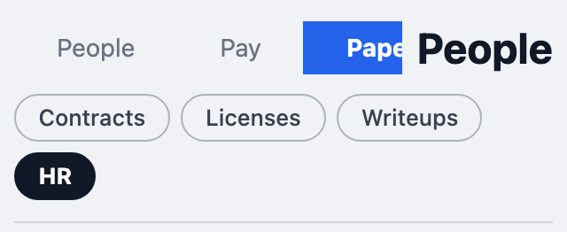
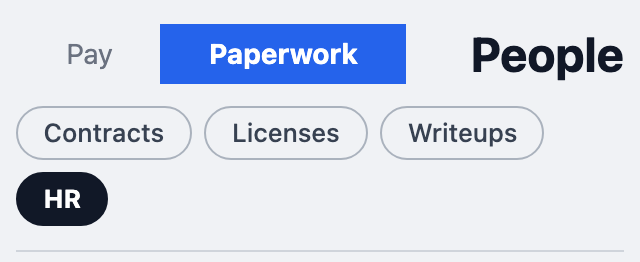

# v2.8130 — People: on a phone, the section you are in shows whole (2026-11-20)

Found by the audit of punch list #315, on a 320 px walk of People → Paperwork → HR. No migration, no seat change.

## What was wrong

The People page draws its six sections (People, Pay, Paperwork, Fleet & Housing, Review, Feedback) in one row that scrolls sideways, with the page title at its right end (`src/pages/People.tsx`). The row always opened scrolled to its start, wherever the lit section sat. Measured on the dev server, the lit section's hidden part:

| Width | Open on | Lit section | Hidden before | Hidden now |
| --- | --- | --- | --- | --- |
| 320 px | HR | Paperwork | 66 px of it, under the title | none |
| 360 px | Activity | Review | all of it | none |
| 390 px | Feedback | Feedback | all of it | none |

At 390 px the row shows People, Pay and Paperwork and ends there, so every view of Fleet & Housing, Review and Feedback opened with no lit section in sight. Narrower phones show less.

## What changed

The row uses `useLitPillInView` (v2.7878), the hook that keeps the Prospects pills and the Permits step strip in view. It moves the row sideways and only the row, when the row first draws, when the section changes and when the window changes width. A new `LIT_SELECTED` names a tablist's selected tab for it. The page never scrolled in the walk.

| Before | After |
| --- | --- |
|  |  |
|  |  |

## Verification

- `useLitPillInView.render.test.tsx`: a new case reads a tablist's selected tab.
- A Playwright walk on the dev server at 320, 360 and 390 px, light and dark, before and after, measuring the lit tab against the row. The shots are cropped to the header, so no person's name is in them.
- In the app's browser pane at 360 px: whole on load, and whole after pressing Pay, Fleet & Housing and Paperwork in turn, with no console error. Narrowing a page the pane had drawn wide sent no resize event, so the row stayed put until a resize event came. A phone draws at its own width from the start.
