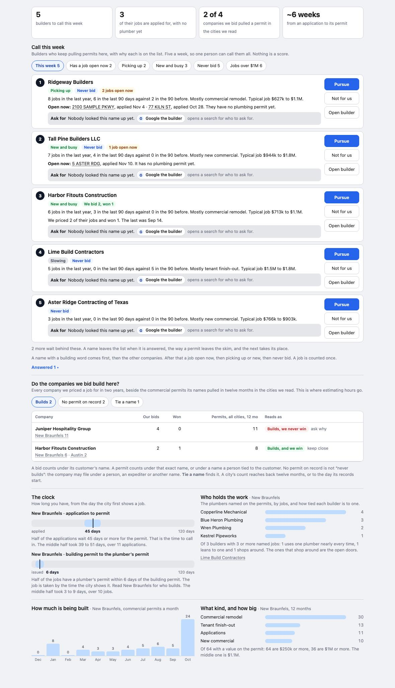
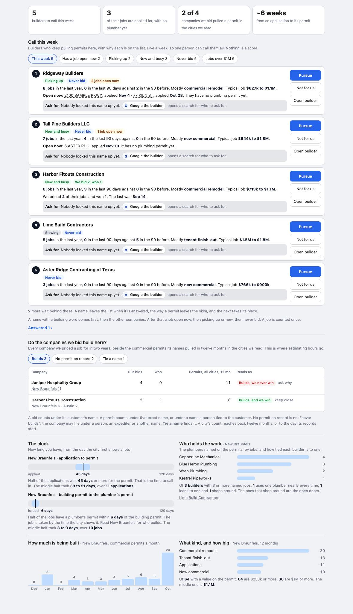
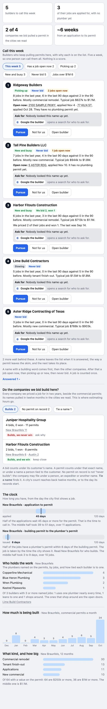
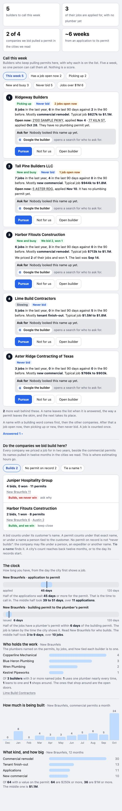
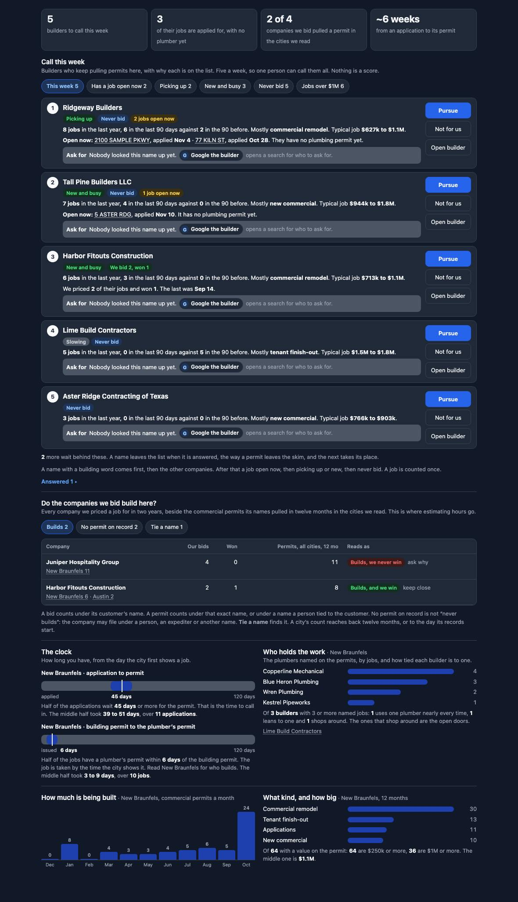
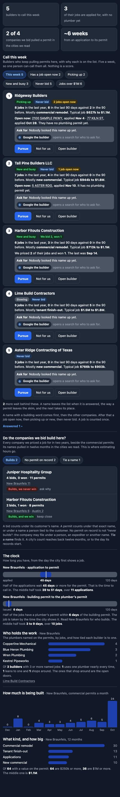

# v2.8149 — Permits, Market: the numbers, days and names in each line stand out in bold (2026-11-20)

Punch list #405 ([the card](../../to-dos/permits-market-page/README.md)), the last of three lines its audit of 2026-11-20 left under *Seen while building, not done*: **Market does not draw its values in place.**

## The rule

*Values in place* ([CLAUDE.md](../../CLAUDE.md), Working conventions): a screen draws a date, a count, a name or an amount apart from the words around it, so the eye can run down the values alone. A value a person can change is underlined and tinted. A value the app works out is plain bold.

The rule reached `CLAUDE.md` in v2.7985, while Market was being built. Market's tiles, its table's columns and its bars already stood apart. Its sentences did not: *8 jobs in the last year, 6 in the last 90 days against 2 in the 90 before* was one run of plain words.

## What changed

Every value on Market is worked out by the app. Nothing on the page is typed in. So each value draws as `WorkedOutValue`, plain bold, and none is underlined or a press.

| Where | The values now drawn apart |
|---|---|
| A row of **Call this week** | its jobs, the two ninety-day counts, the day its records start where they are short, what it mostly builds, its typical job, each open job's applied day, our bids, our wins and the day of the last |
| Under the list | how many more names wait, and the day a short city's records start |
| **Answered** | who answered, the day, and the day the name is off the list until |
| The table of companies | on a phone, a company's bids, wins and permits, which are the desk's three columns folded into one line. The name on the permits that may be theirs |
| **The clock** | the middle wait, the middle half, and how many jobs it is over |
| **Who holds the work** | how many builders are judged, and the three ways they split |
| **What kind, and how big** | the four numbers of the size line |

The words are the same as before, to the letter, but for one: with a single name behind the week's five the line now reads *1 more waits*, where it read *1 more wait*. No number moved.

## How

As the card set it out, and as the Ask for block on the same page already did (v2.8121):

- The kernels mark each value in a sentence with `val` (`src/lib/valuesInPlace.ts`): `permitCallList.ts`, `permitMarket.ts`, `permitMarketShape.ts`.
- The screens draw the sentence with `ValueSentence`: `PermitCallList.tsx`, `PermitMarket.tsx`, `PermitMarketShape.tsx`. A value a screen puts in a line itself, such as an open job's applied day, is a `WorkedOutValue` there.
- Two lines that the screens used to build moved into the kernels so they could be marked: `callWaitingWords` and `companyCountsWords`.
- A toast cannot draw a value apart, so `answeredWords` stays plain, and a test holds that.

## Before and after

Every company, street and number in these pictures is made up. They are the real components on invented rows, drawn under one city's name so that every part of the page shows. No read reached the database.

At a desk, 1180 px, light:

| Before | After |
|---|---|
|  |  |

On a phone, light. Headless Chrome draws no narrower than 500 px, so these are 500 wide with the phone layout on:

| Before | After |
|---|---|
|  |  |

Dark, after:

| At a desk | On a phone |
|---|---|
|  |  |

## The walk

The real page, on the dev server, signed in, read only. Nothing was pressed that writes: no Pursue, no answer, no Checked. Read from the page's own elements, not from pictures, since the rows are real companies.

| | Values drawn apart | Weight | Least contrast | Underlined or a press | Past the right edge |
|---|---|---|---|---|---|
| San Antonio, 1280 px, light | 38 | 700 | 15.8 to 1 | none | none |
| San Antonio, 1280 px, dark | 38 | 700 | 14 to 1 | none | none |
| San Antonio, 375 px, light | 65, with each company's three counts in its line | 700 | 15.8 to 1 | none | none |
| San Antonio, 375 px, dark | 65 | 700 | 14 to 1 | none | none |
| Austin, 1280 px, dark | 24, the plumber clock's note and the split of builders among them | not read | not read | not read | none |

The counts are of values on the screen that day, not of anything about a company.

No mark from a kernel's sentence showed as text anywhere, and the page did not scroll sideways at either width.

## Tests

- `permitCallList.test.ts`, `permitMarket.test.ts`, `permitMarketShape.test.ts`: each sentence's plain words are what they were, and its values are the ones marked, in order.
- `PermitCallList.render.test.tsx`, `PermitMarket.render.test.tsx`: each line reads as before, its values are drawn as worked out, and no value on the page is a press.

## Seen, not changed

- A pursue keeps its reason with a full stop, and the line under **Answered** adds its own, so it can read *Pursued for this job..* It is a line on the card.

## Files

- `src/lib/research/permitCallList.ts`, `permitMarket.ts`, `permitMarketShape.ts`
- `src/components/prospects/PermitCallList.tsx`, `PermitMarket.tsx`, `PermitMarketShape.tsx`
- their kernel and render tests
- `src/content/help/research-permits-for-work-to-bid.md`
- the card: the line marked built, and five smaller findings of the audit put under *Still the owner's to say*, each with a pick
