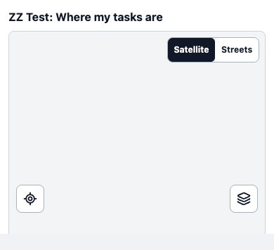
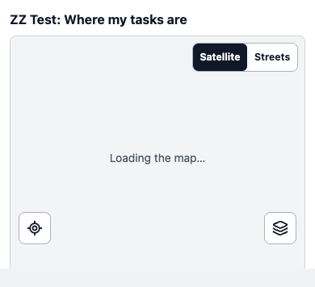
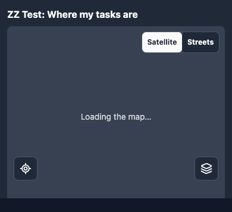
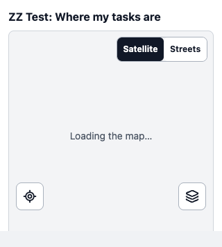
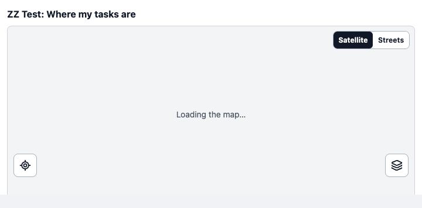

# v2.8179 — Maps: a map of dots waiting on Google Maps says it is loading (2026-11-21)

Found on the live walk of step 5 of punch list [#387](../../to-dos/painted-maps-on-google.md) on 2026-11-21, read in the code and not seen there. Taunya said to mend it the same day. Client only: no migration and no function.

## What was wrong

v2.8078 gave the painted map's Google canvas a line of words for the wait on Google's script. The other Google canvas, `PinsMapGoogleCanvas`, got none. Every map of dots draws on it through `PinsMapFrame`: the person's task map, the team's, the Dashboard's jobs, the Bid Board's, the Jobs page's, the clocked-in map, the home map window and the prospects map.

Until Google's script is in, the library draws an empty div. The frame was a grey box under the card's own presses, with no word, for up to the ten seconds of the load timeout before the Leaflet canvas came up.

The frame did have a line for the wait before that one, on the canvas's own code: *Loading map…* at its top left, in the muted text token. On the frame's grey that pair reads 4.4 to 1 in light and 4.1 to 1 in dark.

## What changed

One line, `MapLoadingLine`, for both waits:

- `PinsMapFrame` draws it while the canvas's own code is on its way, in place of its old line.
- `PinsMapGoogleCanvas` draws it until the loader says the script is in (`loaded`, the fact its doors already read).

It says *Loading the map…*, the words of v2.8078 and of the app's other maps, with `role="status"`. It sits in the middle of the frame, where no press is: the view presses are at the top right and a card's own at the bottom corners. It takes no press. Its colour is `--text-600`, which reads 6.9 to 1 on the frame's grey in light and 7.0 to 1 in dark.

Nothing about what draws on Google changed, nor how often: no map is made sooner, later or again.

## Seen

On a scratch page, not the live site and not a dev server: the real `PinsMapFrame` and `PinsMapGoogleCanvas` in a one-shot bundle, two made-up dots, a made-up key, and Google's script held and never answered. The **Show where I am** press is copied by hand from the task card, at its size and spot. No request left the Mac.

| Look, three seconds in | Before | After |
|---|---|---|
| 390 px, light | an empty grey frame under the presses | *Loading the map…* in the middle |
| 390 px, dark | not shot | the same, in the lighter words |
| 320 px, light | not shot | the words clear every press: 17 px tall at 187 px down, the presses end at 88 px and start at 263 px |
| 720 px card at a desk, light | an empty grey frame | the same line in the middle |

    

Not seen: the words leaving as a real script comes in. The test holds that, with the library stood in.

## Tests

- `PinsMapGoogleCanvas.render.test.tsx`, 19 (3 new): with the script held back the frame says *Loading the map…* in the map's own frame and takes no press, a script that is in says nothing, and the words leave with the frame when the wait runs out.
- `PinsMapFrame.render.test.tsx`, 26 (1 new): the frame says the same line in its own box while the canvas's code is on its way, and stops when the canvas is up.

## Not changed, for the owner

- **The ten seconds.** The load timeout is shared with every Google map (`useGoogleCanvasDoors`), as v2.8078 left it.
- After the script is in, a frame Google has not painted yet is still empty until it paints, or until the paint clock gives up on it at eight seconds. That is the wait of a refused key, and a refused key is remembered for the page since v2.8076.
