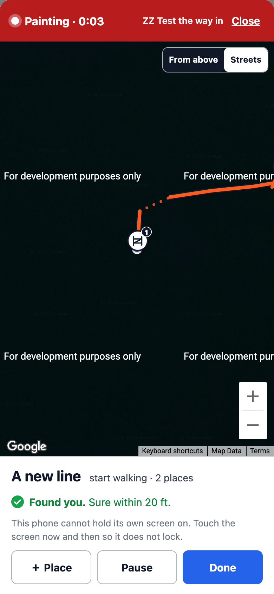
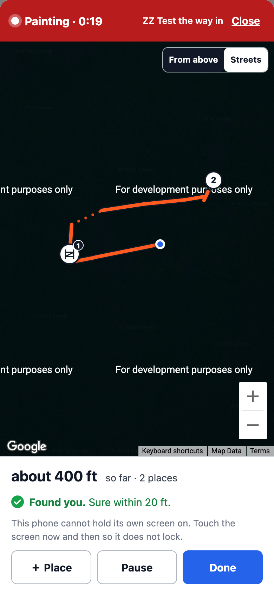
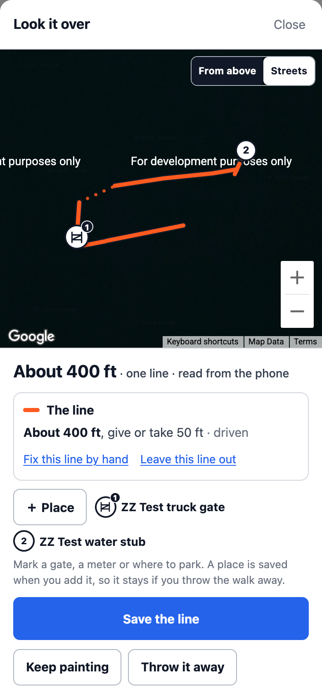

# v2.8212 — Painted maps: a walk is painted on Google Maps (2026-11-21)

Step 3 of punch list [#387](../../to-dos/painted-maps-on-google.md), its first part of three. Taunya asked for step 3 on 2026-11-21, with call 6 settled on her word from her lawyer the same day. Client only: no migration and no function.

## What changed

A walk's line comes from the phone's readings, and the canvas only has to show it and keep the walker in view. So the walk moves to Google first, before the two parts that take a finger on the map.

- **The rule.** `PAINTED_GOOGLE_REACH.uses` gains `'walking'` (`paintedMapProvider.ts`). A walk is on Google from its first reading to Done, paused or not, since the use is read from the window's mode. Look it over was already on Google as looking.
- **Following the walker.** New kernel `src/lib/paintedMap/followMe.ts`, with the Leaflet canvas's own numbers: the map is left alone while the walker is in its middle, and slides to them when they come within a quarter of the box's shorter side of any edge. `PaintedMapGoogleCanvas` takes `follow` and asks it on each reading. An area is never slid to.
- **Only the line that grew.** The window hands a new list of lines on every reading. The Google canvas now keeps each line it drew and draws again only one whose points, unsure stretches or kind changed. The saved lines beside a walk are not touched while it grows.
- **Still on the Leaflet canvas.** Fixing a walked line by hand is drawing, and **＋ Place** is placing. Each still brings the Leaflet canvas up, and the window keeps it until it closes, as before.

Nothing about how often a Google map is made changes: the window keeps its one map from reading through the walk to Look it over, where before the walk brought the Leaflet canvas up and kept it.

## Seen

On a local dev server at 390 px with a touch screen, signed in through the dev login, with a made-up map fed on the read (`ZZ Test the way in`, on nobody's land in the middle of the country), every table write refused before it left the browser, and the phone's readings made up. Google's own script, asked for with no key: the tiles wear Google's *For development purposes only* watermark and nothing is on the deploy's count. Nothing was written to the database.

| Step | Read from the page |
|---|---|
| A saved map, read | Google, one map, no Leaflet map, both places |
| **Walk or drive it**, first reading | Google, the same map, the walker's dot in the middle |
| Twelve readings, ten metres apart, heading east | the dot drifted from the middle to 72% of the way across, and on the next reading the map had slid it back to the middle |
| **Pause**, then on again | Google, the same map |
| **Done** | **Look it over** on Google, the whole of the saved line and the walk in the picture |
| **Throw it away** | Google, reading again |

One request for Google's script in the whole visit, and no write was tried.

  

Not seen: Google's clean tiles under the walk, which need the deploy's key, and a walk outdoors on a phone in a hand.

## Tests

- `followMe.test.ts`, 6 (new): the middle, each edge, off the picture, a map that has not settled, a box with no size, the spot handed back alone.
- `PaintedMapGoogleCanvas.render.test.tsx`, 45 (6 new): only the line that grew is drawn again, nothing is drawn for a reading that changed no line, a line that leaves comes off and every line comes off with the canvas, a changed line is drawn again, the map slides only at the edge, and never without `follow` or to an area.
- `PaintedMapCanvas.google.render.test.tsx`, 23 (3 new): a walk is on Google with `follow`, one Google map serves reading, the walk and Look it over, and fixing a line by hand goes to the Leaflet map and stays.
- `paintedMapProvider.test.ts`, 26 (1 new): a walk is on Google, and drawing and placing are still off it.
- Every test under `src/lib/paintedMap` and `src/components/paintedMap` and the public page's smoke pass.

## Docs

The guide `paint-a-map` says a walk is painted on Google Maps and the map follows you. The Glossary's *Painted map* entry and the card's step 3 line are amended.
