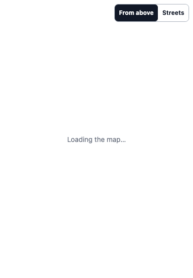
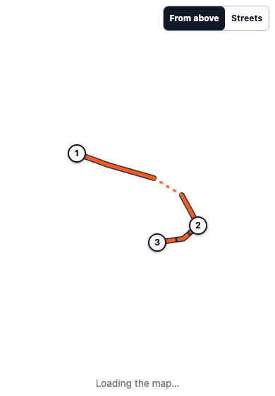
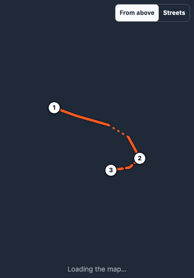
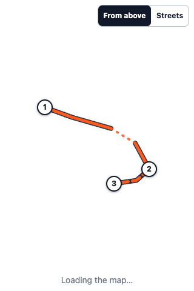
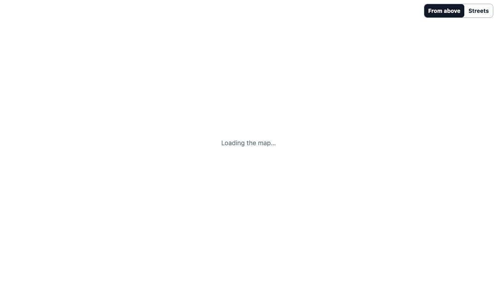
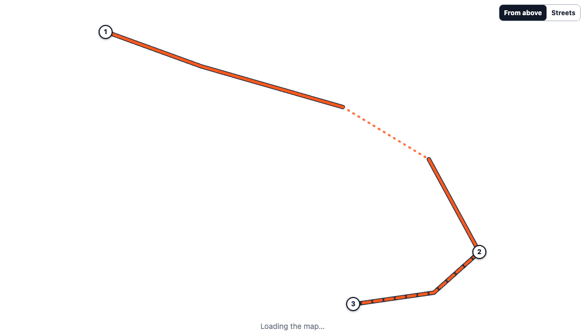
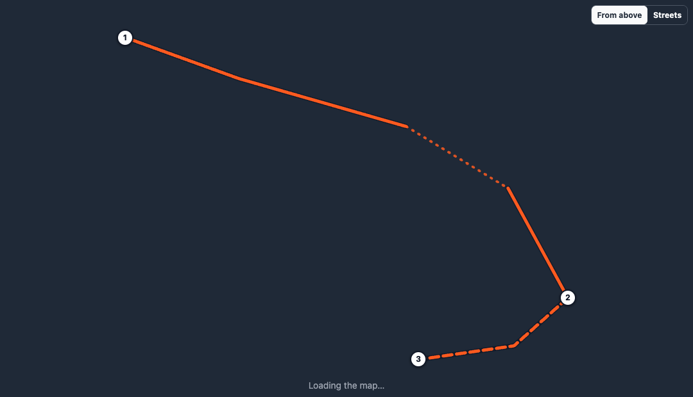

# v2.8213 — Painted maps: the lines show at once while Google Maps loads (2026-11-21)

The second of the two calls the audit of punch list [#387](../../to-dos/painted-maps-on-google.md) left open, *the ten seconds*. Taunya picked it on 2026-11-21 from four choices, shown with a timing table and pictures: *Lines at once*. Client only: no migration and no function.

## What was wrong

A painted map is read in the field. Since v2.7990 a saved map opened to be read draws on Google's map, and until Google's script is in there is no map to draw a line on. The frame held only *Loading the map…* (v2.8078) for as long as the script took, up to the ten seconds of the load timeout, and then the Leaflet canvas came up. Before v2.7990 the lines drew at once and only the photograph was late.

## The choices, and what each would cost

| | First sight of the lines | What it could break |
|---|---|---|
| Today | when Google's script is in, or at 10.1 s on the Leaflet canvas | nothing new |
| A shorter wait, 4 s, for painted maps alone | at most 4.1 s | a phone whose script takes 5 to 10 s never gets Google for that visit, on any painted map, since a failure is kept for the page. The reader still sees nothing for 4 s. |
| The Leaflet canvas while Google loads, then Google's map in its place | at once | Esri's tiles are fetched on the weak signal only to be thrown away, the photograph shifts a few feet under the line when the two change places, and the change can come under a moving finger |
| **A plain drawing while Google loads (built)** | at once | the drawing cannot be dragged or zoomed until the map is up |

The drawing gives what the Leaflet canvas would, the lines at once, with none of its costs: no second map is made, no tile is fetched, and no photograph changes under the line.

It is for the painted canvas alone. The load timeout, `GOOGLE_LOAD_TIMEOUT_MS`, is shared by every Google map and is unchanged at ten seconds. A map of dots still says *Loading the map…* while it waits (v2.8179).

## What changed

- **`paintedWaitSketch.ts`**, a kernel: a point on the ground to a pixel of the frame, for the view the map opens on (`paintedOpeningView`, which the Google canvas already works out before its map is made), by the web maps' own maths (`worldPx`). Each line becomes SVG path data, in its three looks: sure, drawn by hand, and a stretch the phone was not sure of.
- **`PaintedWaitSketch.tsx`**: the drawing. An SVG of the lines, stroked as both canvases stroke them, and the numbered places as the kernel's own marks (`placeMarkHtml`), each on the pixel Google's map will put it. A place takes a press, as on the map. The rest lets every press through.
- **`PaintedMapGoogleCanvas.tsx`** mounts it inside its `APIProvider`: one line, and the loading words move to the bottom of the frame while there is something drawn, into the 40 px the first view keeps clear (`PAINTED_FIT_PAD`), so they never sit on a line. An empty map keeps them in the middle.

When the drawing goes, whichever is first:

- Google's map says it has settled (`idle`).
- The reader begins to move the map (`dragstart`, `zoom_changed`).
- Three seconds after the script came in (`WAIT_SKETCH_LINGER_MS`), for a map that never says. Google's own lines are drawn by then.
- The load timeout runs out and the Leaflet canvas takes the frame, as before.

On a page where Google's map code is already in, the drawing never shows: a map that comes back from Time, a second painted map opened, a painted map opened over a page whose own Google map loaded the script. The map is up at once there, and a drawing held over a kept map could sit on a view the reader has moved.

**Google's count.** The drawing makes no map and asks no server for anything. Google's map is made at the moment it was made before, once and no more. A reader who presses **Draw a line** during the wait leaves Google's map unmade, as before.

## Seen

On a scratch page, not the live site and not a dev server: the real `PaintedMapCanvas` with its Google canvas in a one-shot bundle, a made-up key, a made-up map on public ground (a walked line with an unsure stretch, a line drawn by hand, three places), and Google's script held back by the test browser and then let through with the key taken off its address. Google draws its own tiles with a watermark there.

First sight of the lines and places, in seconds from the open:

| Google's script takes | Today | A 4 s wait | The drawing (built) |
|---|---|---|---|
| 0.5 s | 1.1 | 1.1 | 0.1, Google's map at 1.0 |
| 3 s | 3.7 | 3.7 | 0.1, Google's map at 3.6 |
| 8 s | 8.6 | 4.1, on Leaflet for the visit | 0.1, Google's map at 8.5 |
| never | 10.1, on Leaflet | 4.1, on Leaflet | 0.1, Leaflet at 10.1 |

The drawing left within 0.1 s of Google's map each time. Each place's middle was measured in the drawing and then on Google's map in the same run, at 320, 390 and 1,080 px: nine places, each within one pixel of itself, which is how the two round a half.

Two seconds into an eight second wait:

   

  

The pictures of the same runs once Google's map was in are kept beside the walk's notes and not in the repo, since they are Google's map.

Not seen: a real weak signal on a phone in a hand, and the live site, where Google's script was in within a second on every open of the walks so far. The shipped build is walked after the merge, with the script as fast as it comes.

## Tests

- `paintedWaitSketch.test.ts`: the middle of the view is the middle of the box, the view's corners are the box's corners, a zoom closer doubles every distance, a fitted view keeps its room, and the three looks of a line.
- `PaintedWaitSketch.render.test.tsx`: what it draws and where, a press on a place, and each way it goes, with the page where Google is already in.
- `PaintedMapGoogleCanvas.render.test.tsx`: the canvas mounts the drawing for the wait and moves its words under it.
