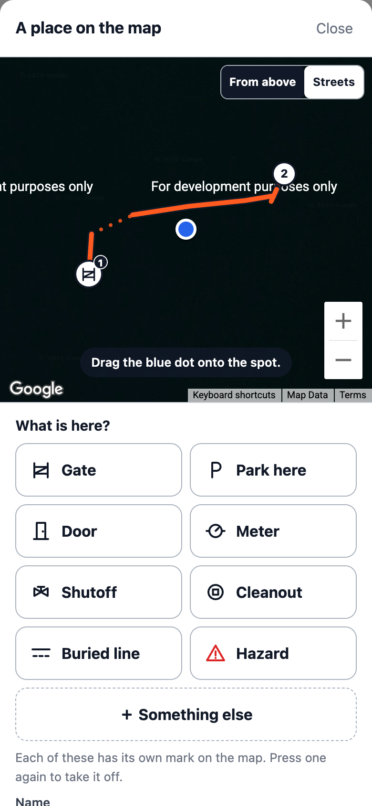
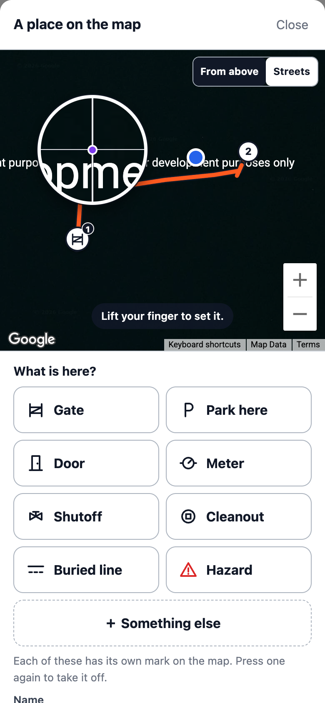
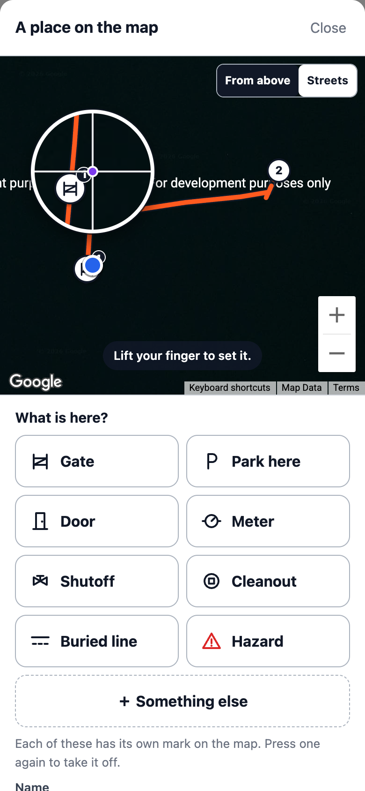

# v2.8235 — Painted maps: a place's dot is put down on Google Maps (2026-11-21)

Step 3 of punch list [#387](../../to-dos/painted-maps-on-google.md), its second part of three, after the walk (v2.8212). Taunya asked for step 3 on 2026-11-21. Client only: no migration and no function.

## What changed

- **The rule.** `PAINTED_GOOGLE_REACH.uses` gains `'placing'` (`paintedMapProvider.ts`). **＋ Place** no longer brings the Leaflet canvas up, so a window that reads a map and adds a place keeps its one Google map.
- **The dot.** `PaintedMapGoogleCanvas` takes `dot`. It is one of Google's own markers, since Google's marker takes HTML only on a map with a Map ID. It wears the Leaflet canvas's dot as a picture, in a 44 px box a fingertip can find. A drag moves it, a press on the map brings it there, and it lands on a target it nears when the caller hands targets.
- **The glass.** A fingertip hides the spot it is placing, so the glass rides above the finger, or to a side when the top of the map is near. Its picture is a second small Google map (`paintedGoogleGlassMap.ts`), as the card's call 5 picked: made the first time a finger places something, kept for the page, and used again for every drag and every painted map after it. It shows the big map's own view at the big map's zoom, drawn four times the size. A glass that asked Google for a closer zoom would be blank wherever Google has no photograph that close. The lines, the places and the cross are drawn over it by the app, sharp, placed by the same arithmetic the map uses.
- **One set of rules.** `src/lib/paintedMap/handPlacing.ts` (new) holds the catch (14 px on the screen, never under the map's own snap and never over 15 m), the move a finger is making laid over a line's corners, the held press's numbers, and where the glass sits. The Leaflet canvas now reads them from there in place of its own copies, with no change in what it does.

## What it costs on Google's count

A phone that places a dot makes two Google maps in a visit where it made one: the map, and the glass's. The glass's is made once for the page, however many drags follow. A mouse gets no glass and makes one map. Nothing else about when a map is made changes.

## Seen

On a local dev server at 390 px with a touch screen, signed in through the dev login, with a made-up map fed on the read (`ZZ Test the way in`, on nobody's land), every table write refused before it left the browser, and Google's own script asked for with no key. The tiles wear Google's *For development purposes only* watermark, and nothing is on the deploy's count. Nothing was written to the database.

| Step | Read from the page |
|---|---|
| A saved map, read | Google, one map made |
| **＋ Place** | the same Google map, no Leaflet map, the dot in the middle of the map |
| A finger drags the dot | the dot follows, and the glass is up beside it, with the kept map in it and the map's lines drawn over it. Two Google maps made |
| The finger lifts | the dot stays where it was let go, and the glass is gone |
| The dot is dragged to the gate | the gate's mark is drawn in the glass |
| A press on the map, away from the dot | the dot is there |
| **Cancel** | reading again, on the same Google map. Two maps made in the whole visit, one request for Google's script |

  

Two things are Google's own and differ from the Leaflet canvas:

- Google's marker trails a dragging finger by about 17 px. The glass shows the dot's spot, which is where it lands.
- A press within about 40 px of the dot goes to the dot and not to the map. Further away, the press brings the dot there.

Not seen: Google's clean tiles in the glass, which need the deploy's key. The window hands a dot no targets today, so the catch is held by tests and was not seen on the page.

## Tests

- `handPlacing.test.ts`, 14 (new): the catch's reach and its two limits, where a dragged point lands, the move laid over the corners, where the glass sits at every edge, and the spot under a press.
- `PaintedMapGoogleCanvas.render.test.tsx`, 11 new: the marker and its picture, the drag and the lift, a press on the map, the catch, a new spot from the caller, leaving, no glass for a mouse, the glass with the kept map and what is drawn in it, one glass map for the page, and the green ring.
- `PaintedMapCanvas.google.render.test.tsx`, 3 new: placing is on Google with no Leaflet map, one Google map from reading to placing and back, and the words for what the dot caught.
- `paintedMapProvider.test.ts`: placing is on Google, and drawing a line by hand is still off it.
- Every test under the painted map's and the maps' folders passes, the Leaflet canvas's own among them.

## Docs

The guide `paint-a-map`, the Glossary's *Painted map* entry and the card's step 3 line.
