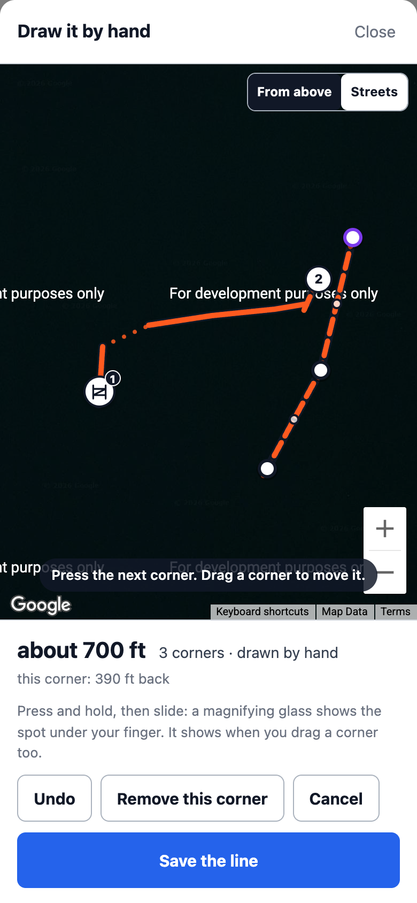
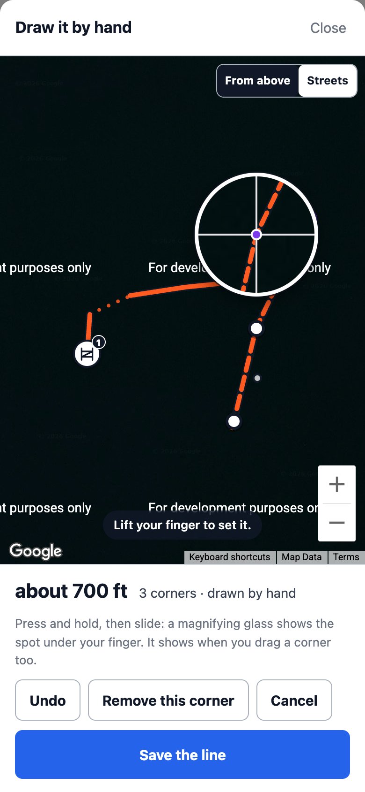
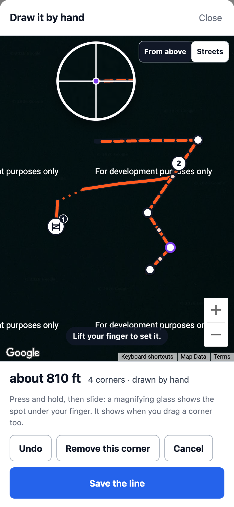
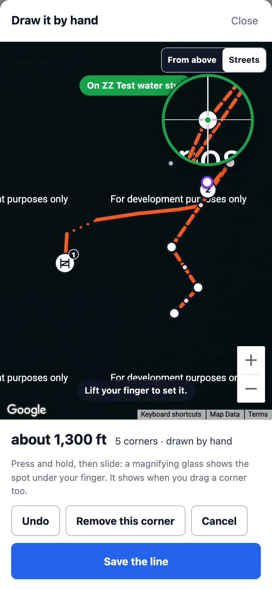

# v2.8236 — Painted maps: a line is drawn by hand on Google Maps (2026-11-21)

Step 3 of punch list [#387](../../to-dos/painted-maps-on-google.md), its last part of three, after the walk (v2.8212) and placing (v2.8235). Client only: no migration and no function.

## The call it waited on

Drawing by hand over Google's photograph was the card's call 6. The card read Google's terms (3.2.3 (c), content made from its content) as a reason not to build it, and said plainly that this was a reading and not legal advice. On 2026-11-21 Taunya answered it: she asked a lawyer, and reports his answer that the paragraph does not stop this, since the drawn maps are not sold to anyone else. The card records it as her word.

## What changed

- **The rule.** `PAINTED_GOOGLE_REACH.uses` gains `'drawing'`, the last word. Every use is now within Google's reach, so the painting window is on Google from the moment it opens to Save. **Time** and a picture of the map still bring the Leaflet canvas up, and a window that made a picture keeps it, as before.
- **Presses on the map.** `PaintedMapGoogleCanvas` takes `draft`. A press adds a corner at the end of the line. A press held still for 380 ms, then slid, places a corner under the glass, and lifting sets it. While it is held the map does not move under the finger. A mouse places with a click and gets no hold and no glass.
- **Corners and middles.** Each corner, and the small dot in the middle of each leg, is one of Google's own markers wearing the Leaflet canvas's drawing in a box a fingertip can find. A drag on a corner moves it. A drag on a middle dot makes a corner there. A press on a corner picks it, for **Remove this corner**.
- **The catch.** A corner dragged near a place or the end of another line lands on it, by the rule both canvases read (`handPlacing.ts`). The window says *On …* and the glass's ring turns green.
- **The line in hand** is one pair of Google's lines, drawn over every saved line, moved as the finger moves and never remade. The glass draws it too.

Nothing about when a Google map is made changes beyond v2.8235: a phone that draws makes the map and, once for the page, the glass's.

## Seen

On a local dev server at 390 px with a touch screen, signed in through the dev login, with a made-up map fed on the read (`ZZ Test the way in`, on nobody's land), every table write refused before it left the browser, and Google's own script asked for with no key. The tiles wear Google's *For development purposes only* watermark, and nothing is on the deploy's count. Nothing was written to the database.

| Step | Read from the page |
|---|---|
| **Draw a line** | the same Google map the saved map was read on, no Leaflet map |
| Three presses on the ground | three corners and two middle dots, *about 700 ft, 3 corners, drawn by hand* |
| A corner dragged | the glass above it, with the kept map in it and the lines drawn over it. The corner let go 54 px to the left, where the finger took it |
| A middle dot dragged | a fourth corner, in that leg |
| A press held still | the glass up at 0.7 s with no finger moved |
| The held press slid, then lifted | a fifth corner where the finger lifted. No other corner moved on the screen, so the map stayed still under the finger |
| The last corner dragged to a place | *On ZZ Test water stub*, the glass's ring green, and the corner let go exactly on the place |
| A press on a corner | the window's words turn to that corner |

Two Google maps in the whole visit, the map and the glass's, one request for Google's script, and no write was tried.

   

Not seen: a real finger on a real phone, and Google's clean tiles, which need the deploy's key. Google's marker trails a dragging finger by about 17 px, as v2.8235 says: the glass shows the corner's own spot.

## After a second read of the code

Another reader went through the whole of step 3 with no part of this write-up in front of them. They found nothing serious. Two finger gestures they suspected were tried on the same local server, and neither misbehaves:

| Gesture | Suspected | Seen |
|---|---|---|
| A press held still until the glass shows, then lifted in place | two corners | one corner |
| A press 14 px and 32 px from a corner, held, slid and lifted | the corner moved and a corner added | the corner moved, none added |
| The same press 40 px from a corner | | one corner added, none moved |

Their fixes went in all the same, since each is small and a real phone has not been tried:

- A held press is quiet from the moment it begins, not from the lift, so a press Google tells the map of during the hold is never a second corner.
- A corner's or a middle dot's own drag or press ends a hold the same press began.
- The glass keeps one map for each look, light and dark. Before, going dark, light and dark again made a third.
- A drawing or a placing that ends with a finger still down leaves no glass up.

## Tests

- `PaintedMapGoogleCanvas.render.test.tsx`, 19 new, five of them for the second read's fixes: the corners and middles, the picked corner's ring, the line in hand, a press on the map, a press on a corner, a corner dragged, a middle dragged, the catch, the corners made again, the held press with the map held still, a slide before the hold and a second finger, no hold for a mouse or on a marker, the glass's line, and letting go of everything.
- `PaintedMapCanvas.google.render.test.tsx`: a line is drawn on the Google map it was read on, the map stays Google's after the save and in a window that opened to draw, a walked line fixed by hand stays on it, and the Leaflet canvas takes the line up on the same spot when Google fails under it.
- `paintedMapProvider.test.ts`: every use is on Google on both screens, Time, a picture and a still still take it down, and a window that drew on the Leaflet canvas still keeps it.
- Every test under the painted map's folders passes, the Leaflet canvas's own among them.

## Docs

The guide `paint-a-map` says drawing is on Google Maps and that the map stays there until Save, and moves the line about two photographs to where it still applies: a picture and a printed page. The Glossary's *Painted map* entry and the card's step 3 line are amended.
