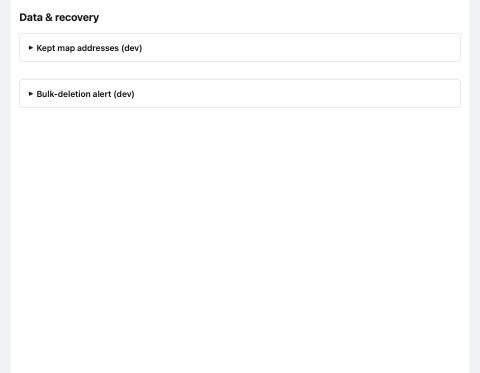
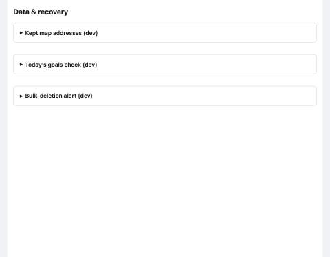
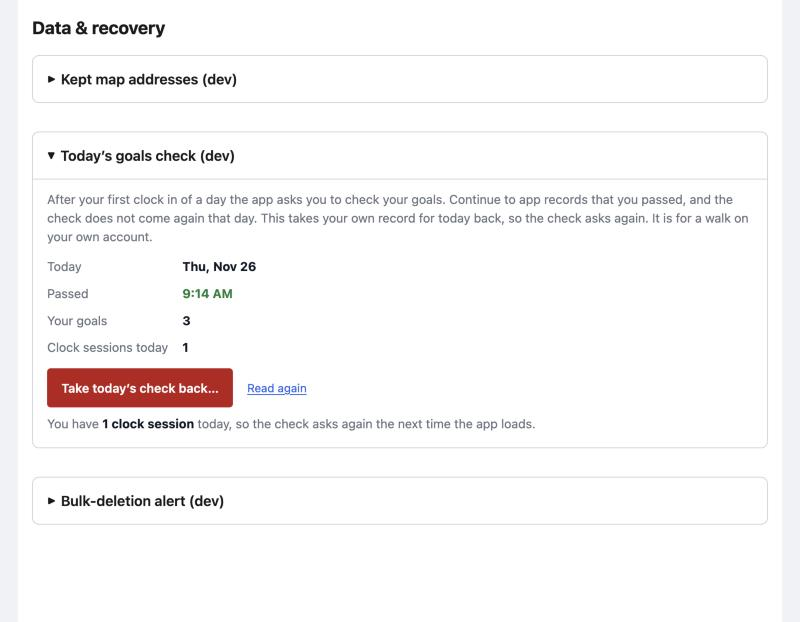
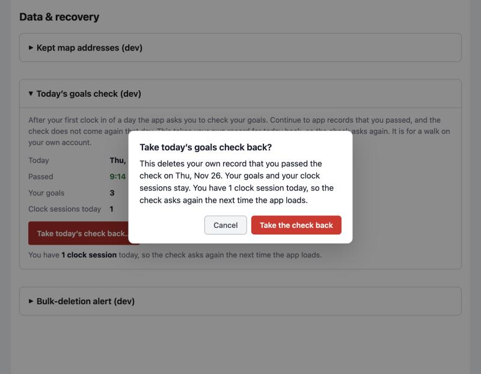
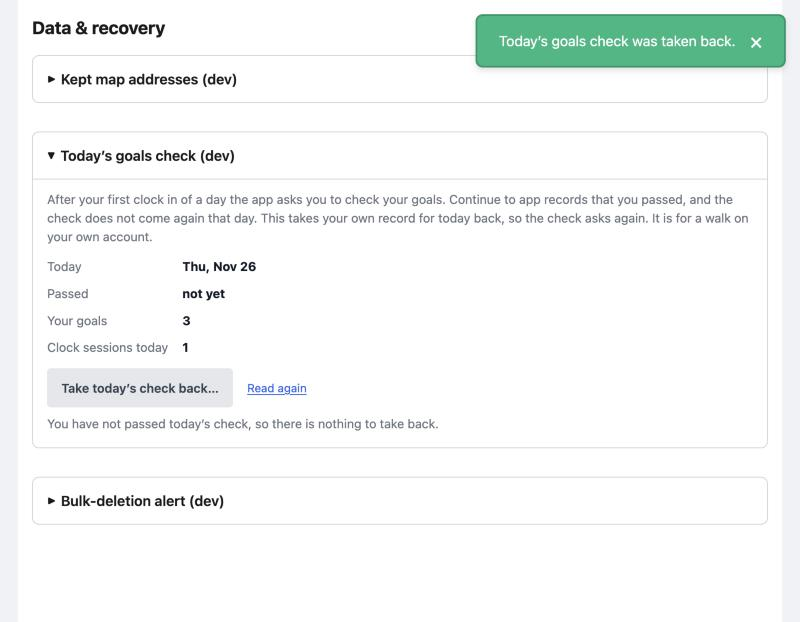
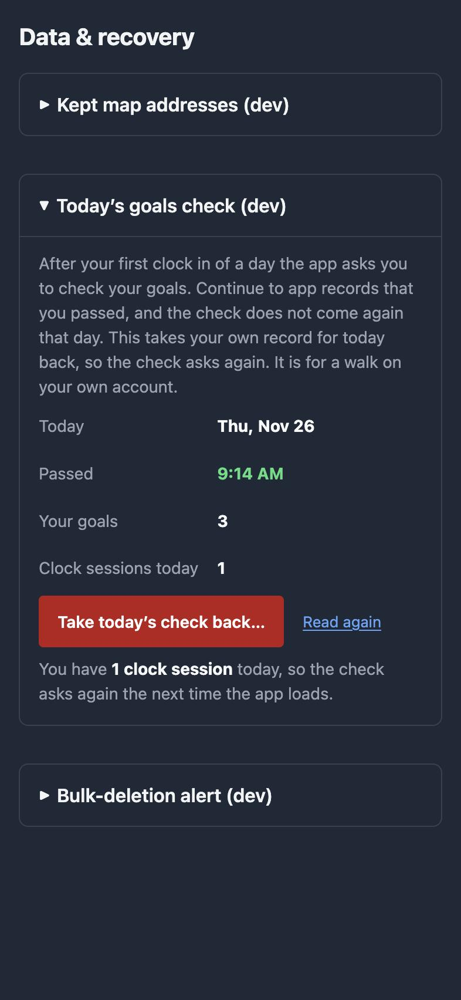

# v2.8675 — Settings: the developer can take today's goals check back (2026-11-26)

Punch list #443, row 19. Client only: no migration, no edge function, nothing owed after the merge.

## The press nothing took back

**Continue to app**, on the day's goals check. After a person's first clock in of a day the app covers itself with that person's goals (`DailyGoalsGateOverlay`). The press writes one `user_daily_goals_ack` row for the person and the day (`upsertDailyGoalsAck`), and the check does not come again that day, on any device. Nothing deleted the row. A walk that clocked in on the dev's own account used up that account's check for the day, so the walking thread held two recipes of card #445 on 2026-11-26.

## The table's policies, read before the build

The card's row said the table lets a person manage their own row. Held against `origin/main` before any code was written:

- `supabase/migrations/20250101000000_baseline.sql` creates one policy on the table, *Users manage own daily goals ack*. It names no statement, so it is for all four, with `auth.uid() = user_id` as both its `USING` and its `WITH CHECK`.
- The same file grants the table whole to `authenticated`. No later migration revokes any of it, drops the policy or adds one. The table is named again only in the three account-merge functions.
- The app's fences sit on every table: a read-only account, a digital twin and an archived caller are each refused a delete. None of them is a dev at work.

So a signed-in dev deletes their own row and nobody else's, with the client alone. No migration.

## What changed

- `src/lib/goalsCheckTakeBack.ts`, the rule, pure. `goalsCheckTakeBackDrawn(role)` is true for a dev alone. `goalsCheckDays(appDay, deviceDay)` is what *today* means to the gate: the company's day and the device's own, once each. `goalsCheckTakeBackProblem(role, today)` refuses a role that is not a dev, a day that could not be read and a check that is not passed. `goalsCheckAsksAgain(today)` says when the check comes again, its count marked as a value. `goalsCheckTakeBackConfirm(today)` is the confirm window's words.
- `src/lib/goalsCheckTakeBackIo.ts`. `readGoalsCheckToday(userId, days)` reads the person's own records for today, how many goals they have and how many clock sessions they have today, and throws when any of the three fails. `takeGoalsCheckBack(userId, days)` deletes by the one `user_id` and the days, once, says so when it reaches no row, and sends nothing with no person or no day.
- `src/components/settings/GoalsCheckTakeBackBlock.tsx`, drawn by `SettingsDataTab.tsx` after *Kept map addresses*. Folded, and it reads nothing until it is opened. Open, it draws four facts one a line, values in place: today's day, when the check was passed or *not yet*, the account's goals and its clock sessions today. Under them, **Take today's check back…** and **Read again**, and one sentence that says when the check asks again.
- `SettingsDataTab.tsx` takes `myUserId`, and `Settings.tsx` hands it the signed-in person.
- `src/lib/settings/devDoors.ts`, `docs/ACCESS_CONTROL.md` row 83, `docs/SETTINGS_TABS_ARCHITECTURE.md` and the glossary's *My Roles Goals / Daily goals gate* entry name the block.

## What the confirm says

*Take today's goals check back?* Then: *This deletes your own record that you passed the check on Thu, Nov 26. Your goals and your clock sessions stay.* and the sentence for when it asks again. The button reads **Take the check back**.

## When the check asks again

The gate's own rule, read in `dailyGoalsGate.ts` and not changed here:

- With a clock session today, the check asks at the next load of the app (`shouldOpenGateOnAppLoad`). A second clock in the same day does not raise it, because it is not the day's first.
- With no clock session today, it asks after the first clock in (`shouldOpenGateAfterFirstClockIn`).
- With no goals, it never asks.

So a walk that wants the dev's real first clock in to meet the check deletes its own clock session first, by rejecting it and then deleting it on People → Hours. A walk that leaves its session standing meets the check at the next load. The block says which of the two holds before the press.

## Why two days

The gate reads the device's own day when the app loads and the company's day at a clock in, and writes the record under whichever asked. On a device in the company's time zone they are one day. On a device in another zone they can differ near midnight, so the read and the delete name both.

## Who sees it

A dev, on their own account. `SettingsDataTab` gates the block on the signed-in role, and the block checks the role again itself. View as a sample account is that account, so it draws nothing. The read and the delete name the signed-in person's `user_id`, and the table's policy lets nobody reach another person's row.

## Pictures

Drawn on a scratch page in this worktree that mounts the real block, with every request that leaves the machine answered from canned data. No live site was opened and nothing on prod was read or written. Before: the tab's blocks with no goals check among them.

 

 

 

## Tests

- `goalsCheckTakeBack.test.ts`: the gate over every role, the two days, each refusal with its words, the three sentences for when it asks again and that each is plain words, the confirm's words and its button.
- `goalsCheckTakeBackIo.test.ts`: the three reads' statements, a failed count, the delete's statement, both days named, a delete that reaches no row, nothing sent with no person or no day, and a refusal sent once.
- `GoalsCheckTakeBackBlock.render.test.tsx`: nothing for eight roles or with no signed-in person, folded with no read, the four facts drawn apart from their labels, the confirm and the take-back and the second read, Cancel, a check not passed, the two other sentences, a failed read with **Read again**, and a refused take-back.

## No guide

No guide covers the developer's blocks on Data & recovery, and the sibling take-backs shipped none.

## Not walked

Not pressed on the live site. One goals check row stands on the dev's own account for 2026-11-26 (card #443, *What sits on prod*). It is that day's row, so the press reaches it only on that day.

## The walk, for the walker

Each step that presses is a write on prod and waits for its own yes.

1. As the sample assistant through View as: Settings. There is no **Data & recovery** tab for an assistant, and no *Today's goals check* block anywhere.
2. As the dev, on a day the account has not passed the check: Settings → **Data & recovery** → **Today's goals check (dev)**. *Passed* reads *not yet*, the press is grey, and the line under it says there is nothing to take back.
3. As the dev, on a day the account passed the check: the block reads the time. Press **Take today's check back…**, read the confirm, and press **Take the check back**. The toast reads *Today's goals check was taken back.* and *Passed* reads *not yet*.
4. Read `user_daily_goals_ack` through the dev seat for the account and the day: no row.
5. With no clock session that day, clock in: the goals check covers the app.
