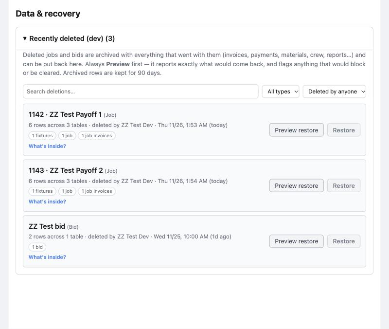
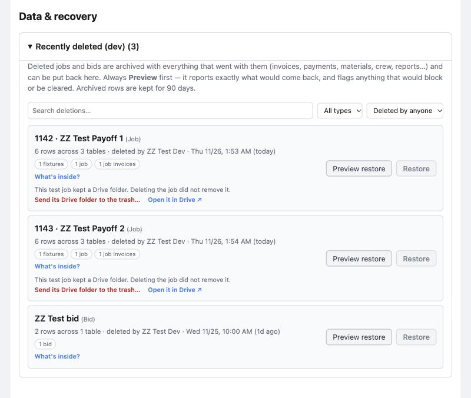
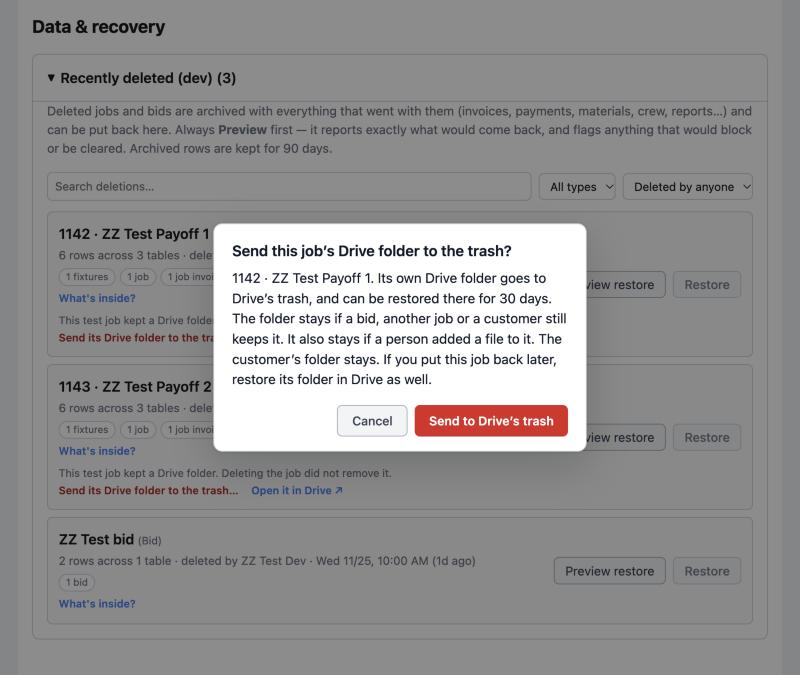
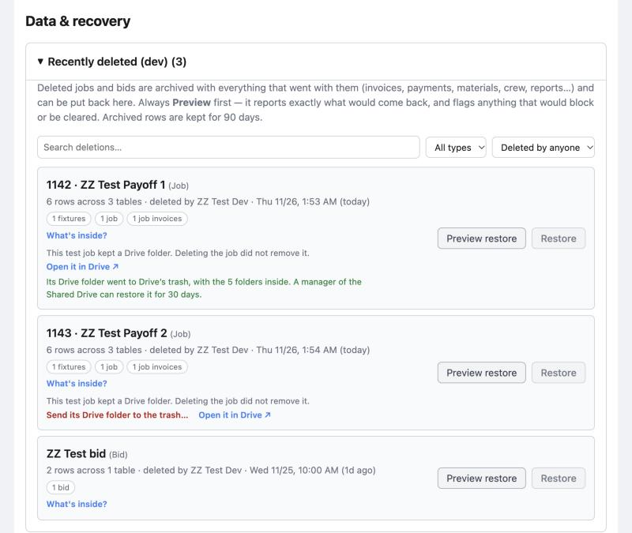
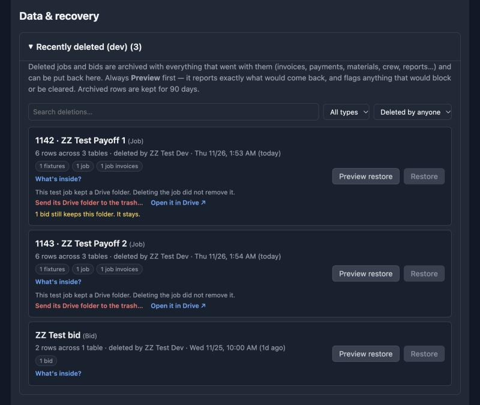
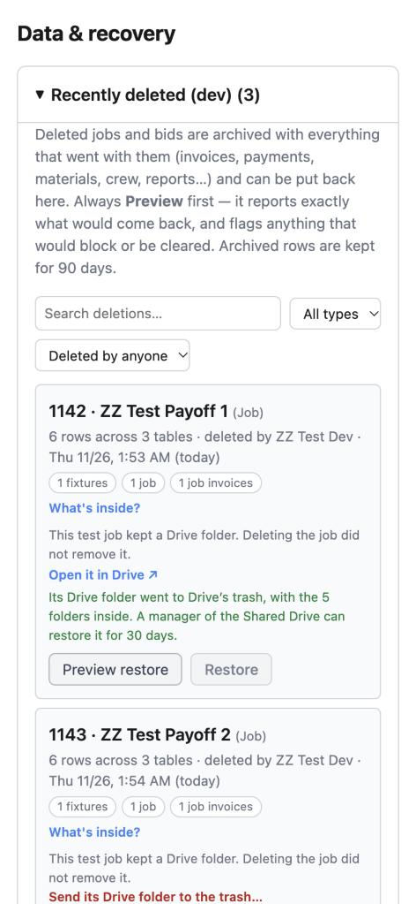

# v2.8688 — Recently deleted: the developer can send a deleted ZZ test job's Drive folder to the trash (2026-11-26)

Punch list #443, row 18, its second half. Client only. No migration and no edge function change: the press sends the body `job-drive-folders` has carried since v2.8681, deployed 2026-11-27. **Owed after the merge: nothing.**

## What v2.8681 left

v2.8681 sends a ZZ test job's own Drive folder to Drive's trash when a dev deletes the job. It asks at the moment of the delete and nowhere else. So three kinds of test job kept their folder:

- one deleted before v2.8681 was live,
- one the office deleted, since the ask is a dev's,
- one whose ask was refused, or lost on the way.

Two folder trees stood in the Shared Drive from a walk of 2026-11-26 for the first reason, on a person's by-hand list.

The function never needed the delete to be the moment. It reads the deleted job from Deleted records, which keeps a job 90 days. This is the press that asks it later.

## What changed

- `src/lib/jobs/deletedJobFolderOffer.ts` gains the Recently deleted half, pure: `deletedBundleFolderOffered(role, kind, job)`, the line, the press's name, `deletedBundleFolderConfirm(label)`, `deletedBundleFolderOutcome(...)` and `deletedJobFolderFacts(rows)`.
- `src/lib/jobs/jobDriveFoldersIo.ts` gains `readDeletedJobFolderFacts(jobIds)`: one read of `deleted_records_archive` for the listed job bundles, three columns of each kept row (the job's name, its customer's name, its Drive link) and no more.
- `src/components/settings/DeletedJobFolderLine.tsx`, new: the line on a bundle's card.
- `src/components/settings/DeletedRecordsSection.tsx` reads the facts once a list and draws the line under **What's inside?**.
- The guide *recover a deleted job or bid* has a section for it.

## Who sees it, and on which entry

A dev, on the entry of a deleted **job** whose kept copy is ZZ-named and keeps a Drive link. The rule is the app's one rule, `isZzTestJob`: the job's own name or its customer's starts with ZZ. A real job's entry, a bid's entry and every other kind are as they were. Recently deleted is a dev's block already.

When the read of the kept copies fails, the cards are as they were, with no line.

## What the press does

The entry reads *This test job kept a Drive folder. Deleting the job did not remove it.* Under it sit **Send its Drive folder to the trash…** and **Open it in Drive ↗**, a link to look first.

The press opens a confirm: *Send this job's Drive folder to the trash?* Its words name the job, then say the folder goes to Drive's trash for 30 days, what keeps a folder, that the customer's folder stays, and to restore the folder too if the job is put back later. Its button reads **Send to Drive's trash**.

Then the app sends `{ trash: { job_id } }` with the bundle's id, and the entry keeps what came back:

- **It went.** The function's words in green, and a toast. The press is gone for this visit. The link stays.
- **Nothing was left to do.** The folder is already in the trash, already gone, or the job kept no folder. Said as done.
- **It stays.** The function's own sentence in amber, and the press stays live. Each refusal reads in its own words: a bid, another job or a customer still keeps it; a person added a file; the job is still here; Deleted records keeps no copy; it is not a job's folder under the jobs root; Drive does not let the app.

A second press on a folder already in the trash writes nothing and says so.

## What the first press would do to the two standing folders

Read on 2026-11-27 through the dev seat, which reads and never writes. No id of either job is written here.

- Both jobs were deleted on 2026-11-26, so Deleted records keeps them until late February 2027.
- Each kept copy holds a ZZ name, a ZZ customer's name, a Drive link and no bid. Neither is restored.
- Each folder is in the company's Shared Drive, not in the trash, under the ZZ customer's folder, which is under *Jobs*.
- Each holds five folders and no file: *Customer Pictures*, *Plans* and *Team only*, with *Photos* and *Sent by us* inside *Team only*.
- The app's own account is a content manager of the drive, the role Drive lets trash.
- Drive names the app's own account as the one that last changed the job's folder. That settles the open point of v2.8681: Drive does fill that fact for the app's account.

So each press should answer *Its Drive folder went to Drive's trash, with the 5 folders inside. A manager of the Shared Drive can restore it for 30 days.* The ZZ customer's folder above them stays, empty: the function never takes a customer's folder.

**Two things were not read.** Whether a live bid, job or customer still names either folder: the function counts that at the press. And whether *Jobs* is the folder the function reads as its root: the seat does not show that setting. If it is not, the answer is *The folder is not under a customer's folder in the jobs root. It stays.* and nothing is written.

## What is not built

- **The customer's folder** still stays, empty or not, as in v2.8681.
- **No batch press.** One entry at a time: each is one folder and one confirm.
- **The entry does not know where the folder is before the press.** The app reads Drive only through the function, so the line shows on every deleted ZZ job that kept a link, one already in the trash too. Its press then says so.
- **No put-back in the app.** A job put back from here keeps its link to a folder in the trash. The confirm says to restore the folder in Drive too.

## Pictures

Drawn on a scratch page in this worktree that mounts the real section, with a stand-in dev and every request that leaves the machine answered from canned data. No live site was opened, and nothing reached prod or Drive.

 

 

 

The first picture of the answer showed a fault: a long answer widened the entry's words and pushed **Preview restore** and **Restore** onto a line below. The answer now takes the width of the words above it and wraps. The picture above is after that mend.

## Tests

- `deletedJobFolderOffer.test.ts`: who is offered the press over every kind of entry and every role, the confirm's words and its button, each sentence in plain words, the outcome's two tones, the kept copies keyed by job.
- `deletedJobFolderFactsIo.test.ts`: the one statement on the archive, nothing read for no job, a read that fails.
- `DeletedJobFolderLine.render.test.tsx`: nothing for six roles and four other entries, the line and the link, the confirm and the ask with the job's id alone, Cancel, an answer that nothing was left to do, and six refusals each in its own words.
- `DeletedRecordsSection.folderLine.render.test.tsx`: the facts read once by the job entries' ids, the line on the ZZ test job alone, and the cards unchanged when the read fails.

## The walk, for the walker

Each step marked **writes** changes Drive or prod and waits for its own yes. The others only read.

1. As the sample assistant through View as: Settings has no **Data & recovery** tab for an assistant. Reads.
2. As the dev: Settings → **Data & recovery** → **Recently deleted (dev)**. Find the two entries named for the ZZ Test Payoff jobs. Each reads *This test job kept a Drive folder.* A real job's entry has no such line. Reads.
3. On the first entry press **Open it in Drive ↗**. The folder opens in Drive with three folders in it. Reads.
4. **Writes, in Drive.** Press **Send its Drive folder to the trash…**, read the confirm, press **Send to Drive's trash**. The entry and a toast read *Its Drive folder went to Drive's trash, with the 5 folders inside.* and the 30 days.
5. In Drive the job's folder is in the trash, with a note in its description that names the job's id. The ZZ customer's folder still stands. Reads.
6. Reload, and press the same entry's press again, then confirm. The entry reads *Its Drive folder is already in Drive's trash.* Nothing is written: the function reads and answers.
7. **Writes, in Drive.** The same on the second entry.
8. Tell the card's keeper: the two folder trees come off *What sits on prod*, and the empty ZZ customer's folder stays on it.
